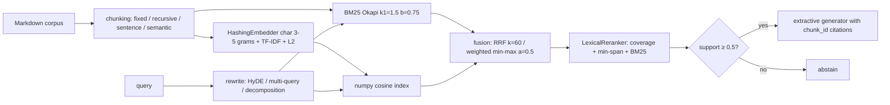

# ragkit

Retrieval-augmented generation built from first principles and benchmarked on two corpora: a self-written, near-saturated energy-flexibility corpus (25 docs, 40 labelled questions), and a harder real-text corpus of 94 EU electricity-regulation articles on grid congestion and balancing (42 agent-drafted questions, see [EU corpus](#real-corpus-eu-electricity-regulation-congestion-and-balancing)).

## Problem
Which retrieval stack actually finds the right document? ragkit implements every stage with no retrieval libraries (BM25, hashing embeddings, fusion, reranking, rewriting, metrics) so each stage can be measured in isolation, offline and deterministically.

## Architecture

Optional extras: `[st]` swaps in `all-MiniLM-L6-v2` embeddings and the `ms-marco-MiniLM-L-6-v2` cross-encoder; `[llm]` adds `AnthropicLLM` (needs `ANTHROPIC_API_KEY`) for rewriting.

## Quickstart
```bash
uv sync
uv run ragkit index src/ragkit/data/corpus     # writes .ragkit/index.json
uv run ragkit ask "What is imbalance settlement?" --index .ragkit/index.json
uv run ragkit ask "What is imbalance settlement?"              # indexes the bundled corpus on the fly
uv run ragkit eval --strategies all                             # or a subset: bm25,dense,hybrid,rerank
uv run ragkit abstention                                        # refuse-on-low-confidence check
uv run ragkit ablation                                          # staged end-to-end table
uv run ragkit eval --corpus eu                                  # same commands on the EUR-Lex corpus
uv run ragkit abstention --corpus eu
uv run ragkit ablation --corpus eu
# any of eval / abstention / ablation also take --corpus-dir, --qa-file, --unanswerable-file
```

## Results
`ragkit eval --strategies all` (recursive chunks of 500 chars, 50 overlap, offline defaults; mean [bootstrap 95% CI over the 40 questions, 2000 resamples]):

| Strategy | Rewrite | Recall@5 | MRR | nDCG@10 |
|---|---|---|---|---|
| BM25 | None | 1.000 [1.000, 1.000] | 0.940 [0.877, 0.988] | 0.955 |
| BM25 | HyDE | 0.975 [0.925, 1.000] | 0.935 [0.871, 0.988] | 0.951 |
| Dense | None | 0.975 [0.925, 1.000] | 0.918 [0.844, 0.981] | 0.938 |
| Dense | HyDE | 0.700 [0.550, 0.850] | 0.513 [0.389, 0.646] | 0.581 |
| Hybrid (RRF) | None | 1.000 [1.000, 1.000] | 0.944 [0.887, 0.988] | 0.958 |
| Hybrid (RRF) | HyDE | 0.925 [0.825, 1.000] | 0.758 [0.658, 0.856] | 0.817 |
| Hybrid + Rerank | None | 0.975 [0.925, 1.000] | 0.942 [0.879, 0.988] | 0.956 |
| Hybrid + Rerank | HyDE | 0.800 [0.675, 0.925] | 0.499 [0.391, 0.608] | 0.603 |

Findings, reported as-is (no tuning on the eval set):
- The QA set is near-saturated: BM25 already reaches recall@5 1.000 and MRR 0.94, because the questions reuse each doc's wording. The table therefore can't separate the methods well: every paired difference among the `None` rows has a bootstrap CI that touches 0 (`ragkit eval` prints them). Hybrid+rerank's 0.975 vs 1.000 means one question out of 40, not a meaningful regression.
- The "+HyDE" rows don't measure HyDE. Offline, `TemplateLLM` appends the same fixed domain paragraph to every query, which acts as a constant keyword prior and pulls queries towards the imbalance, day-ahead and congestion docs. Real HyDE needs `[llm]`.

`ragkit ask "What is imbalance settlement?" --index .ragkit/index.json`, verbatim:
```
Question: What is imbalance settlement?

Answer:
The implementation of 15-minute imbalance settlement periods across Europe is coordinated with centralized balancing energy exchange platforms: PICASSO for automatic Frequency Restoration Reserves (aFRR) and MARI for manual Frequency Restoration Reserves (mFRR). [doc_24_subhourly_dispatch#rec_5] Imbalance settlement is the post-delivery commercial accounting framework that financially penalizes deviations between a Balance Responsible Party's (BRP) contracted market position and its actual metered energy flows. [doc_05_imbalance_settlement#rec_0] A BRP's imbalance volume in settlement period t is defined as:
Imbalance_Volume(t) = Metered_Generation(t) - Metered_Consumption(t) + Contracted_Sales(t) - Contracted_Purchases(t). [doc_05_imbalance_settlement#rec_1]

Citations: doc_24_subhourly_dispatch#rec_5, doc_05_imbalance_settlement#rec_0, doc_05_imbalance_settlement#rec_1
Support: 1.00 (threshold 0.50)
```
Markdown headings are stripped before sentence extraction. Remaining limitation: the top-ranked sentence still comes from a neighbouring doc that mentions the term.

### Refuse on low confidence

`support` = share of the query's content terms (stopwords removed) found in the best retrieved chunk. Below `--min-support` the pipeline abstains instead of answering.

`ragkit abstention`:

| Set | Correct | Rate | Wilson 95% CI |
|---|---|---|---|
| answerable (answered) | 39/40 | 0.97 | [0.87, 1.00] |
| unanswerable near_domain (abstained) | 9/10 | 0.90 | [0.60, 0.98] |
| unanswerable off_domain (abstained) | 6/6 | 1.00 | [0.61, 1.00] |

- The threshold 0.5 is the 5th percentile of support on the 40 answerable questions. The unanswerable set was not used to pick it.
- The 16 unanswerable questions (`data/unanswerable.jsonl`) were written by the author. They are checked against the corpus by keyword, not by an independent annotator. 10 are near-domain (energy topics the corpus does not cover).
- The near-domain miss: "What is the typical cycle life of a sodium-sulfur battery?" reaches support 0.60, because "cycle", "life" and "battery" all appear in the battery doc. Term coverage cannot tell "the corpus talks about this" from "the corpus answers this".

### Staged ablation

`ragkit ablation` runs the full pipeline (retrieve top 5, extractive answer) on the same 40 answerable and 16 unanswerable questions, adding one component per row:

| Stage | Recall@5 | MRR | Answer F1 | Faithfulness | Answered | Abstain (unans.) |
|---|---|---|---|---|---|---|
| BM25 | 1.000 [1.000, 1.000] | 0.940 [0.877, 0.988] | 0.238 | 1.000 | 40/40 | 0/16 |
| + dense (hybrid RRF) | 1.000 [1.000, 1.000] | 0.944 [0.887, 0.988] | 0.220 | 1.000 | 40/40 | 0/16 |
| + lexical rerank | 0.975 [0.925, 1.000] | 0.902 [0.827, 0.971] | 0.235 | 1.000 | 40/40 | 0/16 |
| + refuse (support >= 0.50) | 0.975 [0.925, 1.000] | 0.902 [0.827, 0.971] | 0.234 | 1.000 | 39/40 | 15/16 |

Reading, as measured:
- **The composed pipeline does not beat its stages on answer quality.** Course lesson 69 expects it to; on this corpus it does not. Hybrid adds +0.004 MRR over BM25, the lexical reranker loses one question at recall@5 and 0.04 MRR, and answer F1 stays within 0.22–0.24 for every stage. The only stage that changes behaviour is refusal: 15/16 unanswerable questions refused for 1/40 answerable lost.
- The QA set is too easy to separate retrievers (BM25 already at recall@5 1.000). The EU corpus below is the harder set.
- Faithfulness is 1.000 by construction: the extractive generator only copies corpus sentences. It becomes informative with an LLM generator.
- Answer F1 is low (≈0.23) because reference answers are paraphrases and the extractive answer is up to 3 corpus sentences; it measures token overlap, not correctness.
- The rerank MRR here (0.902) is lower than in the `eval` table (0.942) because the pipeline reranks 10 candidates (`2 × top_k`) while `eval` reranks 20.

## Real corpus: EU electricity regulation, congestion and balancing

The synthetic set cannot separate retrievers, so ragkit also bundles a corpus of real legal text: 94 articles from six EU acts on cross-zonal congestion management and balancing (337 kB of text, 934 chunks at 500 characters).

| Act (CELEX) | Articles kept |
|---|---|
| Regulation (EU) 2019/943, electricity market regulation (32019R0943) | 24 of 71 |
| Commission Regulation (EU) 2017/2195, electricity balancing guideline (32017R2195) | 28 of 65 |
| Commission Regulation (EU) 2015/1222, capacity allocation and congestion management (32015R1222) | 15 of 84 |
| Directive (EU) 2019/944, electricity market directive (32019L0944) | 9 of 74 |
| Commission Regulation (EU) 2017/1485, system operation guideline (32017R1485) | 14 of 192 |
| Commission Regulation (EU) 2016/1719, forward capacity allocation (32016R1719) | 4 of 64 |

Articles were picked by hand for relevance to congestion and balancing, plus neighbours that share vocabulary (definitions, capacity mechanisms, cost recovery, the three near-identical European balancing-platform articles 19/20/21 of 2017/2195) so the corpus has real hard negatives. These are the original Official Journal texts, not consolidated versions; later amendments (for example Regulation (EU) 2024/1747) are not reflected.

**Licence basis.** The EUR-Lex legal notice (<https://eur-lex.europa.eu/content/legal-notice/legal-notice.html>, read 2026-10-16) says: "The Commission's document reuse policy is based on Decision 2011/833/EU. Unless otherwise specified, you can re-use the legal documents published in EUR-Lex for commercial or non-commercial purposes." Decision 2011/833/EU (<https://eur-lex.europa.eu/eli/dec/2011/833/oj/eng>) allows reuse for commercial and non-commercial purposes and states, in Art. 6(2), that conditions may include acknowledging the source and not distorting the original meaning. Both are honoured: every file starts with a source comment, the articles are split but not reworded, and the changes made are listed in `src/ragkit/data/corpus_eu/SOURCES.json` (URL, CELEX id, retrieval date, SHA-256 of each download). This is my reading of the notice, not legal advice; two of the six acts (2019/943, 2019/944) are Parliament and Council acts rather than Commission documents, and I relied on the notice's wording for "legal documents published in EUR-Lex". No Dutch national sources are included.

**How it was built.** `eur-lex.europa.eu` answers scripted requests with an empty HTTP 202 (bot challenge), so the text comes from the Publications Office Cellar endpoint `https://publications.europa.eu/resource/celex/<CELEX>` (English XHTML, retrieved 2026-10-16). `src/ragkit/eurlex.py` parses it with the standard library, cuts one markdown file per article, drops footnote markers and flattens point tables. Rebuild (needs network, caches under the gitignored `data/raw/eurlex/`):

```bash
uv run ragkit fetch-eu --retrieved-on 2026-10-16     # rewrites src/ragkit/data/corpus_eu/
```

Regenerating from the cached download reproduced the committed Markdown files byte for byte (checked with `diff -r`). A fresh download could differ if the Publications Office republishes the XHTML; compare the SHA-256 in `SOURCES.json`.

**Questions.** `qa_eu.jsonl`: 42 answerable (14 `direct`, 20 `paraphrase`, 8 `multi-hop` needing two articles) and `unanswerable_eu.jsonl`: 12 on-topic questions the corpus does not answer. Every record has `provenance` (article ids with paragraph) and `status: "draft-agent"`.

> **These labels were drafted by an AI agent and have not been reviewed.** One annotator, no inter-annotator agreement, and the owner has yet to audit them. Offline tests check that every `relevant_doc_id` exists and that every quoted span in a reference answer occurs verbatim in the cited articles; they do not check that the labels are complete. Where the same rule is repeated in two acts, I labelled both only if the question was written to need both; a paraphrase question may still have an unlabelled second correct article, which would understate recall.

Paraphrase questions avoid the article's wording (for example "A wind farm is switched off by the grid operator without a market mechanism. Is the owner compensated?" for Art. 13 "non-market-based redispatching"). The last row of the table below measures this: the share of a question's content terms found in its best relevant chunk is 0.704 for `direct`, 0.548 for `multi-hop` and 0.336 for `paraphrase`.

### Retrieval: `ragkit eval --corpus eu`

Recursive chunks of 500 characters, 50 overlap, 42 questions, mean [bootstrap 95% CI over questions, 2000 resamples]:

| Strategy | Rewrite | Recall@5 | MRR | nDCG@10 |
|---|---|---|---|---|
| BM25 | None | 0.893 [0.798, 0.964] | 0.663 [0.548, 0.777] | 0.708 |
| BM25 | HyDE | 0.810 [0.690, 0.917] | 0.608 [0.489, 0.726] | 0.649 |
| Dense | None | 0.750 [0.631, 0.857] | 0.639 [0.518, 0.754] | 0.655 |
| Dense | HyDE | 0.298 [0.179, 0.429] | 0.244 [0.151, 0.349] | 0.301 |
| Hybrid (RRF) | None | 0.786 [0.667, 0.893] | 0.665 [0.551, 0.774] | 0.698 |
| Hybrid (RRF) | HyDE | 0.679 [0.548, 0.798] | 0.485 [0.372, 0.601] | 0.541 |
| Hybrid + Rerank | None | 0.821 [0.690, 0.929] | 0.622 [0.510, 0.734] | 0.696 |
| Hybrid + Rerank | HyDE | 0.476 [0.333, 0.619] | 0.300 [0.215, 0.398] | 0.407 |

Paired difference against BM25 / None (same questions; CI of the mean per-question difference):

| Strategy | Rewrite | dRecall@5 | dMRR |
|---|---|---|---|
| BM25 | HyDE | -0.083 [-0.202, +0.024] | -0.056 [-0.130, +0.019] |
| Dense | None | -0.143 [-0.274, -0.012] | -0.024 [-0.136, +0.085] |
| Dense | HyDE | -0.595 [-0.726, -0.452] | -0.419 [-0.550, -0.280] |
| Hybrid (RRF) | None | -0.107 [-0.214, +0.000] | +0.002 [-0.072, +0.079] |
| Hybrid (RRF) | HyDE | -0.214 [-0.357, -0.083] | -0.179 [-0.274, -0.086] |
| Hybrid + Rerank | None | -0.071 [-0.190, +0.036] | -0.041 [-0.136, +0.054] |
| Hybrid + Rerank | HyDE | -0.417 [-0.583, -0.250] | -0.363 [-0.475, -0.249] |

By question type, no rewrite, mean Recall@5 / MRR:

| Strategy | direct (n=14) | multi-hop (n=8) | paraphrase (n=20) |
|---|---|---|---|
| BM25 | 1.000 / 0.833 | 0.812 / 0.938 | 0.850 / 0.435 |
| Dense | 0.929 / 0.832 | 0.688 / 0.938 | 0.650 / 0.385 |
| Hybrid (RRF) | 1.000 / 0.893 | 0.750 / 0.875 | 0.650 / 0.422 |
| Hybrid + Rerank | 1.000 / 0.762 | 0.938 / 0.792 | 0.650 / 0.457 |
| *question terms in best relevant chunk* | 0.704 | 0.548 | 0.336 |

What this does and does not show, as measured:
- **The set is no longer saturated.** BM25 recall@5 falls from 1.000 (synthetic) to 0.893 and MRR from 0.940 to 0.663; the paraphrase subset is where it breaks (MRR 0.435).
- **Separated:** the three template-HyDE rows for Dense, Hybrid and Hybrid+Rerank are clearly below BM25 / None (CIs exclude 0 on both metrics); BM25 + HyDE is not (CI includes 0). Dense is worse than BM25 / None on recall@5 (-0.143, CI excludes 0 but only just), not on MRR. These comparisons are against BM25 / None, not against each method's own no-rewrite row.
- **Still not separated:** BM25 vs Hybrid (recall -0.107, CI upper bound +0.000; MRR +0.002) and BM25 vs Hybrid+Rerank (both CIs include 0). Hybrid fusion with the offline hashing embedder does not add anything over BM25 on this set, and no claim can be made either way about reranking. I did not compute Hybrid vs Hybrid+Rerank directly, so the 0.821 vs 0.786 recall gap between those two rows is untested.
- With n=42 the CIs are wide (about ±0.1 on recall), so differences under roughly 0.1 should be read as ties. The "+HyDE" rows measure the constant-prefix `TemplateLLM`, not real HyDE (see above).
- Multi-hop MRR is higher than recall because MRR only needs the first relevant article, while recall@5 needs both.

### Abstention transfer: `ragkit abstention --corpus eu`

The refusal threshold 0.5 was set on the synthetic answerable set. Applied unchanged to the EU set:

| Set | Correct | Rate | Wilson 95% CI |
|---|---|---|---|
| answerable (answered) | 22/42 | 0.52 | [0.38, 0.67] |
| answerable direct (answered) | 13/14 | 0.93 | [0.69, 0.99] |
| answerable multi-hop (answered) | 4/8 | 0.50 | [0.22, 0.78] |
| answerable paraphrase (answered) | 5/20 | 0.25 | [0.11, 0.47] |
| unanswerable near_domain (abstained) | 9/12 | 0.75 | [0.47, 0.91] |

It does not transfer: 0.5 refuses 48% of answerable questions, and 75% of the paraphrase ones, because those share few words with the article. The command also prints the 5th percentile of support on the answerable set, which is 0.250 here (0.500 on the synthetic set). Re-calibrating the same way (`--min-support 0.25`, chosen from the answerable set only; reported alongside, not replacing the default):

| Set | Correct | Rate | Wilson 95% CI |
|---|---|---|---|
| answerable (answered) | 40/42 | 0.95 | [0.84, 0.99] |
| answerable direct (answered) | 14/14 | 1.00 | [0.78, 1.00] |
| answerable multi-hop (answered) | 8/8 | 1.00 | [0.68, 1.00] |
| answerable paraphrase (answered) | 18/20 | 0.90 | [0.70, 0.97] |
| unanswerable near_domain (abstained) | 1/12 | 0.08 | [0.01, 0.35] |

The default threshold stays 0.5. Operating points on this set (`for t in 0.25 0.30 0.40 0.50; do ragkit abstention --corpus eu --min-support $t; done`), shown as a trade-off curve and not a tuned choice: answered / abstained = 40/42 and 1/12 at 0.25, 34/42 and 2/12 at 0.30, 30/42 and 8/12 at 0.40, 22/42 and 9/12 at 0.50. None of these four points gives both a high answer rate and a high refusal rate. Query-term coverage is a lexical signal: it cannot tell a paraphrased answerable question from an on-topic question whose terms all occur in the corpus (the EU unanswerable set is on-topic by construction). With 12 unanswerable questions the CIs are wide.

### Staged ablation: `ragkit ablation --corpus eu`

| Stage | Recall@5 | MRR | Answer F1 | Faithfulness | Answered | Abstain (unans.) |
|---|---|---|---|---|---|---|
| BM25 | 0.845 [0.738, 0.940] | 0.650 [0.527, 0.769] | 0.238 | 1.000 | 42/42 | 0/12 |
| + dense (hybrid RRF) | 0.726 [0.607, 0.845] | 0.641 [0.514, 0.760] | 0.233 | 1.000 | 42/42 | 0/12 |
| + lexical rerank | 0.750 [0.619, 0.869] | 0.609 [0.484, 0.728] | 0.239 | 1.000 | 42/42 | 0/12 |
| + refuse (support >= 0.50) | 0.750 [0.619, 0.869] | 0.609 [0.484, 0.728] | 0.135 | 1.000 | 22/42 | 9/12 |

- Recall@5 here is lower than in the `eval` table (BM25 0.845 vs 0.893) because the pipeline keeps the top 5 *chunks* and collapses them to documents, which can leave fewer than 5 distinct articles, while `eval` collapses the top 10 chunks first.
- Answer F1 (about 0.24) is almost identical across stages and says little: the extractive generator returns up to three sentences and F1 is token overlap with the quoted reference answer, not correctness. It drops to 0.135 with refusal because refused questions score 0.
- Faithfulness is 1.000 by construction (extractive generator).
- The only stage that changes behaviour is refusal, and at the default threshold it costs 20 of 42 answerable questions to refuse 9 of 12 unanswerable ones (see above).

### Caveats

- Labels are agent-drafted and unreviewed (see the note above); single annotator; 42 and 12 questions.
- English original texts only; not consolidated; amendments after 2019 are absent, so a question about current law may differ from what the corpus says.
- Article-level documents are long (up to about 11k characters), so the 500-character chunks lose the article heading in most chunks; doc-level labels hide that.
- The hashing embedder and lexical reranker are the offline defaults. Neural embeddings (`[st]` extra) were not run, so "dense retrieval does not help" applies to the hashing embedder only.

## Design decisions
- **Protocols for every model boundary** (`Embedder`, `Reranker`, `LLM`, `Generator`): offline defaults keep tests deterministic, and neural models plug in through extras.
- **Hashing embedder instead of a vocabulary**: fixed 512-dim, no fitting state beyond IDF, handles unseen words and typos through char n-grams.
- **RRF as the default fusion**: it is rank-based, so BM25 and cosine scores never need calibration against each other.
- **Extractive generator**: every sentence keeps its `[chunk_id]`, so faithfulness is checkable by construction.
- **Doc-level metrics**: chunks are deduplicated to doc ids before computing recall/MRR/nDCG, matching how `qa.jsonl` is labelled.
- **Persisted index = chunks only**: `ragkit index` writes the chunk list to JSON. BM25 statistics and hashing embeddings are rebuilt from it at load time (milliseconds at this scale), which keeps the format trivial and versionable.