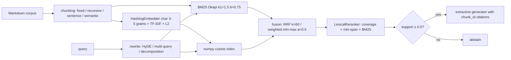

# ragkit

Retrieval-augmented generation built from first principles and benchmarked on two corpora: a self-written, near-saturated energy-flexibility corpus (25 docs, 40 labelled questions), and a harder real-text corpus of 94 EU electricity-regulation articles on grid congestion and balancing (42 agent-drafted, second-pass agent-reviewed questions with no human review, see [EU corpus](#real-corpus-eu-electricity-regulation-congestion-and-balancing)).

## Problem
Which retrieval stack actually finds the right document? ragkit implements every stage with no retrieval libraries (BM25, hashing embeddings, fusion, reranking, rewriting, metrics) so each stage can be measured in isolation, offline and deterministically.

## Architecture

Optional extras: `[st]` swaps in `all-MiniLM-L6-v2` embeddings and the `ms-marco-MiniLM-L-6-v2` cross-encoder, and enables the model-based abstention signals (`ce_top`, `qa_answerable`: `ms-marco-MiniLM-L-6-v2` and `deepset/roberta-base-squad2`); `[llm]` adds `AnthropicLLM` (needs `ANTHROPIC_API_KEY`) for rewriting.

## Quickstart
```bash
uv sync
uv run ragkit index src/ragkit/data/corpus     # writes .ragkit/index.json
uv run ragkit ask "What is imbalance settlement?" --index .ragkit/index.json
uv run ragkit ask "What is imbalance settlement?"              # indexes the bundled corpus on the fly
uv run ragkit eval --strategies all                             # or a subset: bm25,dense,hybrid,rerank
uv run ragkit abstention                                        # refuse-on-low-confidence check
uv run ragkit ablation                                          # staged end-to-end table
uv run ragkit eval --corpus eu                                  # same commands on the EUR-Lex corpus
uv run ragkit abstention --corpus eu
uv run ragkit ablation --corpus eu
uv run ragkit abstention --corpus eu --signals all               # AUROC / risk-coverage / CV and zero-shot thresholds per signal, plus the combined logistic model (nested CV), on all 45 unanswerable questions
uv run ragkit abstention --corpus eu --signals all --cohort original-12   # same on the 12 original unanswerable questions only (`--cohort expanded`: the 33 added ones)
uv run ragkit abstention --corpus synthetic --signals all        # same table on the synthetic set, for contrast
uv run ragkit abstention --corpus eu --signals all --model-signals   # + cross-encoder and SQuAD2 reader signals (needs `uv sync --extra st`; downloads two HF models once)
uv run ragkit lexical --corpus eu                                # model-free lexical retrieval comparison (no model is loaded); `--corpus synthetic` for the regression check
uv run ragkit lexical --corpus eu --explain                      # post-hoc diagnosis of the A0 vs A4 top-5 changes (also model-free)
uv run ragkit beir --dataset scifact                              # BEIR test set, model-free; `--dataset all` for the six datasets below, `--ladder` for the BM25-vs-Pyserini ladder
uv run ragkit legalbench                                          # LegalBench-RAG-mini (776 queries, 72 contracts), official character-overlap metric
# any of eval / abstention / ablation also take --corpus-dir, --qa-file, --unanswerable-file, --cohort
```

## Results
`ragkit eval --strategies all` (recursive chunks of 500 chars, 50 overlap, offline defaults; mean [bootstrap 95% CI over the 40 questions, 2000 resamples]):

| Strategy | Rewrite | Recall@5 | MRR | nDCG@10 |
|---|---|---|---|---|
| BM25 | None | 1.000 [1.000, 1.000] | 0.940 [0.877, 0.988] | 0.955 |
| BM25 | HyDE | 0.975 [0.925, 1.000] | 0.935 [0.871, 0.988] | 0.951 |
| Dense | None | 0.975 [0.925, 1.000] | 0.918 [0.844, 0.981] | 0.938 |
| Dense | HyDE | 0.700 [0.550, 0.850] | 0.513 [0.389, 0.646] | 0.581 |
| Hybrid (RRF) | None | 1.000 [1.000, 1.000] | 0.944 [0.887, 0.988] | 0.958 |
| Hybrid (RRF) | HyDE | 0.925 [0.825, 1.000] | 0.758 [0.658, 0.856] | 0.817 |
| Hybrid + Rerank | None | 0.975 [0.925, 1.000] | 0.942 [0.879, 0.988] | 0.956 |
| Hybrid + Rerank | HyDE | 0.800 [0.675, 0.925] | 0.499 [0.391, 0.608] | 0.603 |

Findings, reported as-is (no tuning on the eval set):
- The QA set is near-saturated: BM25 already reaches recall@5 1.000 and MRR 0.94, because the questions reuse each doc's wording. The table therefore can't separate the methods well: every paired difference among the `None` rows has a bootstrap CI that touches 0 (`ragkit eval` prints them). Hybrid+rerank's 0.975 vs 1.000 means one question out of 40, not a meaningful regression. Paired Hybrid+Rerank minus Hybrid (`uv run ragkit eval --strategies hybrid,rerank`): dRecall@5 -0.025 [-0.075, +0.000], dMRR -0.002 [-0.052, +0.048] without rewrite; with template HyDE dRecall@5 -0.125 [-0.250, +0.025] and dMRR -0.258 [-0.385, -0.131].
- The "+HyDE" rows don't measure HyDE. Offline, `TemplateLLM` appends the same fixed domain paragraph to every query, which acts as a constant keyword prior and pulls queries towards the imbalance, day-ahead and congestion docs. Real HyDE needs `[llm]`.

`ragkit ask "What is imbalance settlement?" --index .ragkit/index.json`, verbatim:
```
Question: What is imbalance settlement?

Answer:
The implementation of 15-minute imbalance settlement periods across Europe is coordinated with centralized balancing energy exchange platforms: PICASSO for automatic Frequency Restoration Reserves (aFRR) and MARI for manual Frequency Restoration Reserves (mFRR). [doc_24_subhourly_dispatch#rec_5] Imbalance settlement is the post-delivery commercial accounting framework that financially penalizes deviations between a Balance Responsible Party's (BRP) contracted market position and its actual metered energy flows. [doc_05_imbalance_settlement#rec_0] A BRP's imbalance volume in settlement period t is defined as:
Imbalance_Volume(t) = Metered_Generation(t) - Metered_Consumption(t) + Contracted_Sales(t) - Contracted_Purchases(t). [doc_05_imbalance_settlement#rec_1]

Citations: doc_24_subhourly_dispatch#rec_5, doc_05_imbalance_settlement#rec_0, doc_05_imbalance_settlement#rec_1
Support: 1.00 (threshold 0.50)
```
Markdown headings are stripped before sentence extraction. Remaining limitation: the top-ranked sentence still comes from a neighbouring doc that mentions the term.

### Refuse on low confidence

`support` = share of the query's content terms (stopwords removed) found in the best retrieved chunk. Below `--min-support` the pipeline abstains instead of answering.

`ragkit abstention`:

| Set | Correct | Rate | Wilson 95% CI |
|---|---|---|---|
| answerable (answered) | 39/40 | 0.97 | [0.87, 1.00] |
| unanswerable near_domain (abstained) | 9/10 | 0.90 | [0.60, 0.98] |
| unanswerable off_domain (abstained) | 6/6 | 1.00 | [0.61, 1.00] |

- The threshold 0.5 is the 5th percentile of support on the 40 answerable questions. The unanswerable set was not used to pick it.
- The 16 unanswerable questions (`data/unanswerable.jsonl`) were written by the author. They are checked against the corpus by keyword, not by an independent annotator. 10 are near-domain (energy topics the corpus does not cover).
- The near-domain miss: "What is the typical cycle life of a sodium-sulfur battery?" reaches support 0.60, because "cycle", "life" and "battery" all appear in the battery doc. Term coverage cannot tell "the corpus talks about this" from "the corpus answers this".

### Staged ablation

`ragkit ablation` runs the full pipeline (retrieve top 5, extractive answer) on the same 40 answerable and 16 unanswerable questions, adding one component per row:

| Stage | Recall@5 | MRR | Answer F1 | Faithfulness | Answered | Abstain (unans.) |
|---|---|---|---|---|---|---|
| BM25 | 1.000 [1.000, 1.000] | 0.940 [0.877, 0.988] | 0.238 | 1.000 | 40/40 | 0/16 |
| + dense (hybrid RRF) | 1.000 [1.000, 1.000] | 0.944 [0.887, 0.988] | 0.220 | 1.000 | 40/40 | 0/16 |
| + lexical rerank | 0.975 [0.925, 1.000] | 0.902 [0.827, 0.971] | 0.235 | 1.000 | 40/40 | 0/16 |
| + refuse (support >= 0.50) | 0.975 [0.925, 1.000] | 0.902 [0.827, 0.971] | 0.234 | 1.000 | 39/40 | 15/16 |

Reading, as measured:
- **The composed pipeline does not beat its stages on answer quality.** Course lesson 69 expects it to; on this corpus it does not. Hybrid adds +0.004 MRR over BM25, the lexical reranker loses one question at recall@5 and 0.04 MRR, and answer F1 stays within 0.22–0.24 for every stage. The only stage that changes behaviour is refusal: 15/16 unanswerable questions refused for 1/40 answerable lost.
- The QA set is too easy to separate retrievers (BM25 already at recall@5 1.000). The EU corpus below is the harder set.
- Faithfulness is 1.000 by construction: the extractive generator only copies corpus sentences. It becomes informative with an LLM generator.
- Answer F1 is low (≈0.23) because reference answers are paraphrases and the extractive answer is up to 3 corpus sentences; it measures token overlap, not correctness.
- The rerank MRR here (0.902) is lower than in the `eval` table (0.942) because the pipeline reranks 10 candidates (`2 × top_k`) while `eval` reranks 20.

## Real corpus: EU electricity regulation, congestion and balancing

The synthetic set cannot separate retrievers, so ragkit also bundles a corpus of real legal text: 94 articles from six EU acts on cross-zonal congestion management and balancing (337 kB of text, 934 chunks at 500 characters).

| Act (CELEX) | Articles kept |
|---|---|
| Regulation (EU) 2019/943, electricity market regulation (32019R0943) | 24 of 71 |
| Commission Regulation (EU) 2017/2195, electricity balancing guideline (32017R2195) | 28 of 65 |
| Commission Regulation (EU) 2015/1222, capacity allocation and congestion management (32015R1222) | 15 of 84 |
| Directive (EU) 2019/944, electricity market directive (32019L0944) | 9 of 74 |
| Commission Regulation (EU) 2017/1485, system operation guideline (32017R1485) | 14 of 192 |
| Commission Regulation (EU) 2016/1719, forward capacity allocation (32016R1719) | 4 of 64 |

Articles were picked by hand for relevance to congestion and balancing, plus neighbours that share vocabulary (definitions, capacity mechanisms, cost recovery, the three near-identical European balancing-platform articles 19/20/21 of 2017/2195) so the corpus has real hard negatives. These are the original Official Journal texts, not consolidated versions; later amendments (for example Regulation (EU) 2024/1747) are not reflected.

**Licence basis.** The EUR-Lex legal notice (<https://eur-lex.europa.eu/content/legal-notice/legal-notice.html>, read 2026-10-16) says: "The Commission's document reuse policy is based on Decision 2011/833/EU. Unless otherwise specified, you can re-use the legal documents published in EUR-Lex for commercial or non-commercial purposes." Decision 2011/833/EU (<https://eur-lex.europa.eu/eli/dec/2011/833/oj/eng>) allows reuse for commercial and non-commercial purposes and states, in Art. 6(2), that conditions may include acknowledging the source and not distorting the original meaning. Both are honoured: every file starts with a source comment, the articles are split but not reworded, and the changes made are listed in `src/ragkit/data/corpus_eu/SOURCES.json` (URL, CELEX id, retrieval date, SHA-256 of each download). This is my reading of the notice, not legal advice; two of the six acts (2019/943, 2019/944) are Parliament and Council acts rather than Commission documents, and I relied on the notice's wording for "legal documents published in EUR-Lex". No Dutch national sources are included.

**How it was built.** `eur-lex.europa.eu` answers scripted requests with an empty HTTP 202 (bot challenge), so the text comes from the Publications Office Cellar endpoint `https://publications.europa.eu/resource/celex/<CELEX>` (English XHTML, retrieved 2026-10-16). `src/ragkit/eurlex.py` parses it with the standard library, cuts one markdown file per article, drops footnote markers and flattens point tables. Rebuild (needs network, caches under the gitignored `data/raw/eurlex/`):

```bash
uv run ragkit fetch-eu --retrieved-on 2026-10-16     # rewrites src/ragkit/data/corpus_eu/
```

Regenerating from the cached download reproduced the committed Markdown files byte for byte (checked with `diff -r`). A fresh download could differ if the Publications Office republishes the XHTML; compare the SHA-256 in `SOURCES.json`.

**Questions.** `qa_eu.jsonl`: 42 answerable (17 `direct`, 17 `paraphrase`, 8 `multi-hop` needing two articles) and `unanswerable_eu.jsonl`: 45 on-topic questions the corpus does not answer. The first 12 are the original set (`"cohort": "original-12"`); 33 were added later (`"cohort": "expanded"`) in four near-miss types tagged `miss_type`: 9 `wrong_regulation` (an EU act the corpus only cites by number), 8 `absent_article` (a plausible article of an included act that is not among the 94), 9 `missing_number` (the corpus names the quantity but states no value) and 7 `national_rule` (Member State or non-EU detail). Every record has `provenance` (closest article ids) and `status: "reviewed-agent"`; the 43 records that a review changed also carry a `review_note` (25 answerable and 3 of the original 12 in the first pass, 15 of the 33 added ones in the second).

> **Review status: second-pass review by a separate agent; no human domain expert has reviewed these labels, and single-annotator risk remains.** The questions were first drafted by one AI agent. A second, independent agent pass then read every cited article and re-checked each answer, each paraphrase and multi-hop claim, and the relevant-article labels against the BM25 and dense top-10 (and checked that none of the 94 articles answers an unanswerable question). It changed 25 of 42 answerable items (13 questions and 19 reference answers rewritten, 4 retyped, 3 relevant ids added and 1 removed) and 3 of 12 unanswerable ones, and dropped none; the per-item log is in [`docs/qa_eu_review.md`](docs/qa_eu_review.md). The reviewers are agents, probably of the same model family as the drafter, so shared blind spots are possible, and the owner could not audit the result. Offline tests check that every `relevant_doc_id` exists and that every quoted span in a reference answer occurs verbatim in the cited articles; they do not check that the labels are complete. Where the same rule is repeated in two acts, both were labelled only if the question needs both.

> **The 33 added unanswerable questions were reviewed in a separate adversarial agent pass; no human saw them either.** Protocol (fixed and committed in `29ffeb7` before any abstention signal was computed on the new questions): draft, check each against BM25/dense/hybrid top-10 and corpus greps, then a second agent tried to prove each one answerable, read every article in the union of the top-10 lists and checked every statement in the `reason` text. Reviewer verdicts, counted from its table: 23 OK, 7 `reason` factually wrong, 2 partial (an article states a maximum settlement period without a value; an EU compensation floor that applies in Germany), 1 compound question. None was found answerable and none was dropped; 4 questions were reworded and 11 reasons corrected. The reviewer is again an agent, probably of the drafter's model family. Closest calls (a nearby threshold, deadline or pricing statement that does not answer the question) are listed in [`docs/qa_eu_review.md`](docs/qa_eu_review.md).

The review changed the benchmark, so the numbers below are not comparable one-to-one with the draft-label run. Draft-label run, for comparison (BM25 / Dense / Hybrid / Hybrid+Rerank, no rewrite, recall@5 / MRR): 0.893 / 0.663, 0.750 / 0.639, 0.786 / 0.665, 0.821 / 0.622. After review: 0.857 / 0.676, 0.619 / 0.528, 0.786 / 0.636, 0.821 / 0.591. Part of the movement is the stricter paraphrase questions (less lexical overlap), part is the added labels; the two effects were not separated.

Paraphrase questions avoid the article's wording (for example "A wind farm is switched off by the grid operator without a market mechanism. Is the owner compensated?" for Art. 13 "non-market-based redispatching"). The last row of the by-type table below measures this: the share of a question's content terms found in its best relevant chunk is 0.669 for `direct`, 0.451 for `multi-hop` and 0.259 for `paraphrase` (draft labels: 0.704, 0.548, 0.336). The reviewer retyped three items from `paraphrase`/`multi-hop` to `direct` because the question reused the article's key phrase or one article sufficed.

### Retrieval: `ragkit eval --corpus eu`

Recursive chunks of 500 characters, 50 overlap, 42 questions, mean [bootstrap 95% CI over questions, 2000 resamples]:

| Strategy | Rewrite | Recall@5 | MRR | nDCG@10 |
|---|---|---|---|---|
| BM25 | None | 0.857 [0.750, 0.952] | 0.676 [0.560, 0.791] | 0.702 |
| BM25 | HyDE | 0.774 [0.655, 0.881] | 0.621 [0.503, 0.736] | 0.650 |
| Dense | None | 0.619 [0.476, 0.750] | 0.528 [0.401, 0.647] | 0.546 |
| Dense | HyDE | 0.298 [0.167, 0.429] | 0.231 [0.142, 0.324] | 0.275 |
| Hybrid (RRF) | None | 0.786 [0.667, 0.893] | 0.636 [0.518, 0.742] | 0.676 |
| Hybrid (RRF) | HyDE | 0.702 [0.571, 0.833] | 0.497 [0.378, 0.625] | 0.539 |
| Hybrid + Rerank | None | 0.821 [0.702, 0.929] | 0.591 [0.483, 0.701] | 0.648 |
| Hybrid + Rerank | HyDE | 0.512 [0.369, 0.643] | 0.327 [0.236, 0.426] | 0.418 |

Paired difference against BM25 / None (same questions; CI of the mean per-question difference):

| Strategy | Rewrite | dRecall@5 | dMRR |
|---|---|---|---|
| BM25 | HyDE | -0.083 [-0.190, +0.000] | -0.055 [-0.127, +0.017] |
| Dense | None | -0.238 [-0.405, -0.083] | -0.147 [-0.279, -0.023] |
| Dense | HyDE | -0.560 [-0.702, -0.429] | -0.445 [-0.572, -0.315] |
| Hybrid (RRF) | None | -0.071 [-0.190, +0.048] | -0.040 [-0.127, +0.050] |
| Hybrid (RRF) | HyDE | -0.155 [-0.274, -0.048] | -0.178 [-0.279, -0.070] |
| Hybrid + Rerank | None | -0.036 [-0.131, +0.048] | -0.084 [-0.172, +0.003] |
| Hybrid + Rerank | HyDE | -0.345 [-0.488, -0.214] | -0.349 [-0.458, -0.245] |

By question type, no rewrite, mean Recall@5 / MRR:

| Strategy | direct (n=17) | multi-hop (n=8) | paraphrase (n=17) |
|---|---|---|---|
| BM25 | 1.000 / 0.828 | 0.750 / 0.938 | 0.765 / 0.400 |
| Dense | 0.853 / 0.726 | 0.688 / 0.812 | 0.353 / 0.197 |
| Hybrid (RRF) | 0.941 / 0.824 | 0.750 / 0.781 | 0.647 / 0.380 |
| Hybrid + Rerank | 1.000 / 0.730 | 0.812 / 0.792 | 0.647 / 0.358 |
| *question terms in best relevant chunk* | 0.669 | 0.451 | 0.259 |

What this does and does not show, as measured:
- **The set is no longer saturated.** BM25 recall@5 falls from 1.000 (synthetic) to 0.857 and MRR from 0.940 to 0.676; the paraphrase subset is where it breaks (MRR 0.400).
- **Separated:** the three template-HyDE rows for Dense, Hybrid and Hybrid+Rerank are clearly below BM25 / None (CIs exclude 0 on both metrics); BM25 + HyDE is not (recall CI upper bound +0.000, MRR CI includes 0). Dense / None is now also separated from BM25 / None on both metrics (recall -0.238, MRR -0.147, CIs exclude 0); on the draft labels it was separated on recall only. These comparisons are against BM25 / None, not against each method's own no-rewrite row.
- **Still not separated:** BM25 vs Hybrid (recall -0.071, CI [-0.190, +0.048]; MRR -0.040, CI includes 0) and BM25 vs Hybrid+Rerank (recall -0.036; MRR -0.084, CI upper bound +0.003). Hybrid fusion with the offline hashing embedder does not add anything over BM25 on this set, and no claim can be made either way about reranking. Hybrid vs Hybrid+Rerank, now computed directly (`uv run ragkit eval --corpus eu --strategies hybrid,rerank`, paired bootstrap over the same 42 questions): dRecall@5 +0.036 [-0.107, +0.167] and dMRR -0.045 [-0.150, +0.059] without rewrite, so the 0.821 vs 0.786 recall gap is a tie. With template HyDE the reranker is worse than Hybrid (dRecall@5 -0.190 [-0.333, -0.060], dMRR -0.170 [-0.287, -0.057]).
- With n=42 the CIs are wide (about ±0.1 on recall), so differences under roughly 0.1 should be read as ties. The "+HyDE" rows measure the constant-prefix `TemplateLLM`, not real HyDE (see above).
- Dense retrieval with the hashing embedder collapses on the reworded paraphrase questions (recall 0.353, MRR 0.197), which is where the lexical overlap was removed.
- Multi-hop MRR is higher than recall because MRR only needs the first relevant article, while recall@5 needs both.

### Model-free lexical retrieval: `ragkit lexical --corpus eu`

Can the paraphrase gap of BM25 be narrowed without any model? Three lexical changes were tried: structure-aware chunking with the heading, BM25F with a heading field, and a hand-written EU synonym/acronym map for query expansion; plus one cross-validated parameter variant. The protocol, parameters, decision rule and the synonym map were committed before anything was scored ([`docs/lexical_protocol.md`](docs/lexical_protocol.md), commit `d605d3e`; the code was committed in `a0d27a4`, still before the first scored run; after that run only the "better / worse / tied" counts were added to the printed report, and the numbers of the other columns were identical before and after).

**Result: the headline configuration A4 is not adopted.** Its paired MRR gain over the pinned BM25 is small and its CI includes 0, and Recall@5 went down (point estimate -0.060, CI includes 0). The pre-registered rule needed an MRR CI above 0 and a non-negative Recall@5 difference; both failed on the EU set.

**What was and was not run.** `ragkit lexical` builds `BM25Index` / `BM25FIndex` only: no embedder, cross-encoder or dense/hybrid index, and no model is loaded (`tests/test_ragkit_lexical.py::test_lexical_command_loads_no_model` runs the command in a subprocess and checks that `sentence_transformers`, `torch` and `transformers` are never imported). `ragkit eval` itself never instantiates `STEmbedder` either (it builds a `HashingEmbedder`), but the dense and hybrid rows were not re-run for this section; their numbers above are unchanged. The baseline A0 is the existing `BM25Index()` on 500-character recursive chunks, not a rewrite, and its row reproduces the BM25 / None row of `ragkit eval` (0.857 / 0.676 / 0.702).

```bash
uv run ragkit lexical --corpus eu        > runs/lexical_eu.txt          # 42 questions
uv run ragkit lexical --corpus synthetic > runs/lexical_synthetic.txt   # 40 questions, regression check
```

| id | configuration (all parameters frozen in the protocol) |
|---|---|
| A0 | existing BM25 (k1 1.5, b 0.75), 500-char recursive chunks, top-10 chunks then deduplicated to articles |
| A1 | A0 but articles ranked from the full chunk list (control for the cutoff change in A2 to A5) |
| A2 | `structured` chunks (paragraph/point units, 250 to 1000 chars, heading prepended), plain BM25 |
| A3 | structured chunks, BM25F with the heading as a field (weight 2, body 1) |
| A4 | A3 + query expansion from the synonym map (expanded terms weighted 0.4) |
| A5 | A4 with (k1, b, heading weight) chosen by stratified 2-fold CV (5 seeds, grid of 4 x 3 x 3), as an extra |

The structured chunker gives 585 chunks (median 464 characters, max 999) against 934 for the recursive one (median 397, max 552), and every chunk keeps its article heading.

EU, 42 questions, mean [bootstrap 95% CI over questions, 2000 resamples]:

| Config | Recall@5 | MRR | nDCG@10 |
|---|---|---|---|
| A0 bm25-pinned | 0.857 [0.750, 0.952] | 0.676 [0.560, 0.791] | 0.702 [0.600, 0.800] |
| A1 +doc-depth | 0.869 [0.762, 0.952] | 0.678 [0.564, 0.792] | 0.720 [0.621, 0.812] |
| A2 +structure | 0.798 [0.679, 0.905] | 0.678 [0.561, 0.792] | 0.708 [0.602, 0.802] |
| A3 +bm25f | 0.798 [0.679, 0.905] | 0.672 [0.550, 0.787] | 0.705 [0.600, 0.800] |
| A4 +expansion | 0.798 [0.679, 0.905] | 0.687 [0.566, 0.799] | 0.717 [0.613, 0.813] |
| A5 +cv-params | 0.798 [0.686, 0.900] | 0.687 [0.569, 0.796] | 0.718 [0.613, 0.813] |

Paired difference against A0 (same questions; CI of the per-question mean difference), and how many of the 42 questions got better / worse / tied:

| Config | dRecall@5 | dMRR | dnDCG@10 | questions better / worse / tied (R@5; MRR) |
|---|---|---|---|---|
| A1 +doc-depth | +0.012 [+0.000, +0.036] | +0.002 [+0.000, +0.007] | +0.017 [+0.000, +0.039] | 1 / 0 / 41; 1 / 0 / 41 |
| A2 +structure | -0.060 [-0.131, +0.000] | +0.002 [-0.039, +0.045] | +0.005 [-0.038, +0.045] | 0 / 3 / 39; 6 / 4 / 32 |
| A3 +bm25f | -0.060 [-0.143, +0.012] | -0.004 [-0.061, +0.048] | +0.003 [-0.050, +0.053] | 1 / 3 / 38; 7 / 7 / 28 |
| A4 +expansion | -0.060 [-0.143, +0.012] | +0.012 [-0.044, +0.066] | +0.014 [-0.040, +0.064] | 1 / 3 / 38; 7 / 7 / 28 |
| A5 +cv-params | -0.060 [-0.140, +0.007] | +0.011 [-0.035, +0.056] | +0.016 [-0.031, +0.060] | 1 / 5 / 36; 8 / 7 / 27 |

By question type, A0 against A4 (mean [95% CI]; paired A4 minus A0 below each metric; all configurations and all three metrics are in `runs/lexical_eu.txt`):

| Metric | Config | direct (n=17) | multi-hop (n=8) | paraphrase (n=17) |
|---|---|---|---|---|
| Recall@5 | A0 | 1.000 [1.000, 1.000] | 0.750 [0.562, 0.938] | 0.765 [0.529, 0.941] |
| Recall@5 | A4 | 1.000 [1.000, 1.000] | 0.812 [0.625, 0.938] | 0.588 [0.353, 0.824] |
| Recall@5 | A4 - A0 | +0.000 [+0.000, +0.000] | +0.062 [+0.000, +0.188] | -0.176 [-0.353, +0.000] |
| MRR | A0 | 0.828 [0.691, 0.941] | 0.938 [0.812, 1.000] | 0.400 [0.226, 0.579] |
| MRR | A4 | 0.855 [0.718, 0.971] | 0.917 [0.750, 1.000] | 0.412 [0.245, 0.585] |
| MRR | A4 - A0 | +0.026 [-0.009, +0.088] | -0.021 [-0.062, +0.000] | +0.012 [-0.118, +0.141] |
| nDCG@10 | A0 | 0.867 [0.768, 0.957] | 0.808 [0.690, 0.916] | 0.488 [0.322, 0.655] |
| nDCG@10 | A4 | 0.891 [0.788, 0.978] | 0.813 [0.667, 0.942] | 0.497 [0.335, 0.659] |
| nDCG@10 | A4 - A0 | +0.024 [-0.005, +0.072] | +0.006 [-0.085, +0.110] | +0.008 [-0.103, +0.114] |

Synthetic corpus (40 questions, regression check, `runs/lexical_synthetic.txt`): Recall@5 is 1.000 for every configuration; MRR goes from 0.940 [0.877, 0.988] (A0) to 0.981 [0.944, 1.000] (A4), paired dMRR +0.042 [+0.000, +0.092] (3 questions better, none worse). No regression there, so condition 3 of the decision rule held.

Decision rule, applied as written (A4 minus A0): EU dMRR +0.012 [-0.044, +0.066], lower bound not above 0 (fails); EU dRecall@5 -0.060, point estimate below 0 (fails); synthetic dMRR +0.042 and dRecall@5 +0.000 (passes). **A4 is not adopted.**

What the numbers do and do not show:
- **No separated gain on EU.** Every overall EU interval for A2 to A5 against A0 includes 0 on all three metrics (A2's Recall@5 interval touches it: [-0.131, +0.000]), and the paraphrase MRR moves from 0.400 to 0.412 (CI of the difference [-0.118, +0.141]). The expansion map did not close the paraphrase gap on this set.
- **Recall@5 fell with the new chunking.** It drops by 0.060 as soon as the structured chunker is used (A2: 3 questions worse, none better), almost entirely in `paraphrase` questions (-0.118 for A2, -0.176 for A3 and A4). The A1 row rules out the article-level cutoff as the cause (A1 is +0.012). The parameters were not adjusted in response, because the protocol forbids tuning on these 42 questions. The cause was investigated afterwards, without changing anything: see "Why it did not help" below.
- **The synthetic gain is not evidence for EU.** On the synthetic set MRR improves by +0.044 from structure alone (A2), where the questions are close to the documents' wording (BM25 MRR 0.940 already); the improvement of A2 over A0 there has a CI that barely excludes 0 ([+0.002, +0.092]) and it is one of many paired intervals in this section.
- **Cross-validated parameters (A5) add nothing.** Held-out A5 is within 0.001 of A4 on MRR, and the chosen (k1, b, heading weight) varies across folds and seeds (8 different points in 10 fold selections, 7 of them with k1 0.9), a sign that the 42 questions do not determine them.
- **Caveats specific to this test.** The relevance labels were reviewed against BM25 and dense top-10 lists (see "Review status"), which can favour BM25-style retrieval and make any lexical change harder to show a gain on. The synonym map was written from the corpus vocabulary and domain knowledge without reading the questions (apart from the two first lines of `qa_eu.jsonl`, listed in the protocol), and the protocol commit precedes every scored run; that guarantees the map was not fitted to the questions, not that it is good. Not tried: RM3 pseudo-relevance feedback, stemming, other chunk sizes, field weights beyond the CV grid. Trying them now on these 42 questions would be tuning on the test set; they need new questions or a fresh protocol.

#### Why it did not help (post-hoc diagnosis, nothing adopted or changed)

```bash
uv run ragkit lexical --corpus eu --explain > runs/lexical_explain_eu.txt   # model-free; code in src/ragkit/lexical_explain.py
```

This was written after the scored run and uses the same 42 questions, so the categories below were chosen after seeing which questions flipped: they describe, they do not test. The command follows each (question, relevant article) pair (52 of them) through A0, A1, a diagnostic stage S0 (structured chunks, body only, plain BM25; not a protocol configuration, it separates chunking from the heading effect that A2 mixes), A3 and A4, and reports every point where an article enters or leaves the top 5. It also prints the full detail for each flipped pair (chunks, per-term scores, heading and expansion terms, top-3 competitors under A4); the full output is in `runs/lexical_explain_eu.txt`.

**What moved.** Top-5 membership differs between A0 and A4 for 4 of the 52 pairs: 3 relevant articles lost, 1 gained (the gain is half a question: Q25 is multi-hop). Those 4 questions account for the whole Recall@5 change (-0.060; the other 38 questions contribute +0.000). They also cost 0.008 MRR, while the other 38 questions add +0.019 MRR from reordering inside the top 5; the near-zero overall MRR change is that sum, not an absence of movement.

**Cause table** (3 lost, 1 gained; the stage is where the pair crossed the top-5 line last):

| Cause | Lost | Gained | Example (relevant article) |
|---|---|---|---|
| Heading field: a competitor's heading contains a query word | 1 | 0 | Q22: `reg_2017_1485_art158` ("FRR minimum technical requirements") gains +4.43 from the single word "technical" and passes the relevant article 25 ("Requirements for standard products"), whose heading shares only "for" with the question |
| Heading field: the relevant article's heading matches nothing, and the field lowers idf of heading words | 1 | 0 | Q24: "General requirements" (article 38); its best-chunk score falls from 10.20 (S0, rank 5) to 9.09 (A3, rank 9) because "exchange", "capacity", "for", "of" occur in headings and the BM25F document frequency counts them there |
| Structured chunking: relevant passage in a longer chunk | 1 | 0 | Q31: the match on "task" sits in a 448-character recursive chunk under A0 (score 7.95, 85% of the top article) but in a 996-character structured chunk (paragraphs 3 and 4 of the article, merged because paragraph 3 is under the 250-character minimum) under S0/A4: score 5.75, 61%, rank 11 |
| Heading field: the relevant article's heading contains a query word | 0 | 1 | Q25: "Imbalance price" gains +0.63 from "price" and the article moves from rank 7 to 5 (3 after expansion) |
| Query expansion | 0 | 0 | no relevant article crosses the top-5 line at this step |

Counting every crossing, not only the net ones (relevant articles out / in): heading field 4 / 1, structured chunking 2 / 2, A0's top-10-chunk cut 0 / 1 (one pair, Q41's `reg_2019_943_art37`, is outside the pinned baseline's ten chunks, enters the top 5 once A1 uses the full chunk list, and leaves again under structured chunking), expansion 0 / 0. In the whole set, 32 articles enter a top 5 at the heading step and 32 leave it, so it reshuffles heavily; of those moves 4 take a relevant article out and 1 puts one in. The `max` versus `sum` of chunk scores is not the cause, since A0 and A4 both rank an article by its best chunk; as a counterfactual only, summing chunk scores would keep Q24's article in the top 5 (rank 3 under A0, 5 under A4) and not the other two lost ones (15 to 14, 6 to 10).

**Why the losses cluster at rank 5 and in paraphrase questions.**
- All three lost articles were at A0 rank exactly 5. Of the 4 relevant articles at A0 rank 5, 1 stays in the top 5 under A4; the 40 at ranks 1 to 4 all stay; the 2 at ranks 6 and 7 do not enter. A0 got these three by sitting on the line, and any reshuffle takes them off it.
- The line is a coin flip on paraphrase questions because their scores are flat: the median score of the 10th article is 0.67 of the first (direct 0.46, multi-hop 0.45), and the gap between the 5th and 6th article is under 5% of the score on 14 of 17 paraphrase questions (9 of 17 direct, 4 of 8 multi-hop). In Q24 the S0 scores of ranks 5 and 6 are 10.20 and 10.16.
- The heading field helps when the question reuses the article's own words and hurts when it does not. The relevant article's heading adds score on its best chunk in 14 of 19 direct pairs against 38 of 66 non-relevant top-5 articles, but in only 8 of 17 paraphrase pairs against 44 of 75 competitors (multi-hop: 9 of 16 against 22 of 27). Paraphrase questions are written without the article's words, so the heading field cannot reward the right article and still rewards competitors whose headings share a word. These counts are small and not tested.

**Hypotheses that were checked and not supported.**
- *Expansion favours definition articles:* the expansion map fires on 27 of 42 questions, mostly through generic words ("border", "network", "zonal", "operator"); it changes the article order in the top 10 on 23 and brings 8 articles into a top 5, none of them a "Definitions" article. Definition articles hold 16 of the 210 top-5 slots under A0 and 8 under A4: they are demoted, not promoted.
- *Generic headings (act name and boilerplate) get boosted:* the heading step's top-5 entries are driven by a word of the article heading in 27 of 32 cases, by the act name alone in 3 and by idf or length shifts alone in 2; the heading field does not work mainly through boilerplate.

**Hypothesis for future work (untested).** The loss comes mostly from the heading field, not from chunking or expansion (2 of the 3 lost pairs, 4 of 6 relevant crossings out). Computing document frequency from the body only (so heading words do not lower idf everywhere, the Q24 mechanism) and capping the heading contribution so that one rare heading word cannot lift an article by more than the typical rank-5 to rank-10 score gap (Q22's +4.43 against a gap of a few tenths) should remove the lost pairs without losing Q25's gain. Not run: it needs new questions or a fresh pre-registered protocol, since these 42 are now used for diagnosis.

### Abstention transfer: `ragkit abstention --corpus eu`

The refusal threshold 0.5 was set on the synthetic answerable set. Applied unchanged to the EU set, with the 12 original unanswerable questions (`ragkit abstention --corpus eu --cohort original-12`; the rerun on all 45 is at the end of this subsection):

| Set | Correct | Rate | Wilson 95% CI |
|---|---|---|---|
| answerable (answered) | 20/42 | 0.48 | [0.33, 0.62] |
| answerable direct (answered) | 14/17 | 0.82 | [0.59, 0.94] |
| answerable multi-hop (answered) | 4/8 | 0.50 | [0.22, 0.78] |
| answerable paraphrase (answered) | 2/17 | 0.12 | [0.03, 0.34] |
| unanswerable near_domain (abstained) | 9/12 | 0.75 | [0.47, 0.91] |

It does not transfer: 0.5 refuses 52% of answerable questions (22 of 42), and 88% of the paraphrase ones (15 of 17), because those share few words with the article. The command also prints the 5th percentile of support on the answerable set, which is 0.250 here (0.500 on the synthetic set). Re-calibrating the same way (`--min-support 0.25`, chosen from the answerable set only; reported alongside, not replacing the default):

| Set | Correct | Rate | Wilson 95% CI |
|---|---|---|---|
| answerable (answered) | 40/42 | 0.95 | [0.84, 0.99] |
| answerable direct (answered) | 17/17 | 1.00 | [0.82, 1.00] |
| answerable multi-hop (answered) | 8/8 | 1.00 | [0.68, 1.00] |
| answerable paraphrase (answered) | 15/17 | 0.88 | [0.66, 0.97] |
| unanswerable near_domain (abstained) | 1/12 | 0.08 | [0.01, 0.35] |

Draft-label run, for comparison: at 0.50 answered 22/42 (direct 13/14, multi-hop 4/8, paraphrase 5/20) and abstained 9/12; at 0.25 answered 40/42 (14/14, 8/8, 18/20) and abstained 1/12.

The default threshold stays 0.5. Operating points on this set (`for t in 0.25 0.30 0.40 0.50; do ragkit abstention --corpus eu --cohort original-12 --min-support $t; done`), shown as a trade-off curve and not a tuned choice: answered / abstained = 40/42 and 1/12 at 0.25, 31/42 and 2/12 at 0.30, 27/42 and 8/12 at 0.40, 20/42 and 9/12 at 0.50 (draft labels: 40/42 and 1/12, 34/42 and 2/12, 30/42 and 8/12, 22/42 and 9/12). None of these four points gives both a high answer rate and a high refusal rate. Query-term coverage is a lexical signal: it cannot tell a paraphrased answerable question from an on-topic question whose terms all occur in the corpus (the EU unanswerable set is on-topic by construction). With 12 unanswerable questions the CIs are wide. The unanswerable questions changed little in the review (3 of 12 edited), so the 9/12 and 1/12 refusal counts are unchanged. After the larger unanswerable set was added, the 12-question tables above were rerun with `--cohort original-12` and reproduce (counts, AUROCs and CV balanced-accuracy ranges unchanged).

With all 45 unanswerable questions (`uv run ragkit abstention --corpus eu --min-support 0.5` and `--min-support 0.25`, answerable side unchanged): 0.50 abstains on 30/45 (0.67, Wilson [0.52, 0.79]); 0.25 abstains on 5/45 (0.11, [0.05, 0.23]). The 33 added questions alone: 21/33 (0.64, [0.47, 0.78]) at 0.50 and 4/33 (0.12, [0.05, 0.27]) at 0.25, so the original 12 (9/12 and 1/12) were not unusually easy or hard. By `miss_type` at 0.50 (abstained): `wrong_regulation` 7/9, `national_rule` 5/7, `missing_number` 5/9, `absent_article` 4/8; at 0.25: 2/9, 2/7, 0/9, 0/8. [INFERENCE] `absent_article` and `missing_number` questions reuse the corpus's own vocabulary most, which may be why the coverage rule abstains least on them; not tested, and each cell has 7 to 9 questions, so the CIs are wide (0.3 or more).

### Abstention signals under domain shift: `ragkit abstention --corpus eu --signals all --cohort original-12`

This subsection is the first measurement, on the 12 original unanswerable questions (plus the later `combined` rows). The 45-question rerun follows in the next subsection.

Question: is query-term coverage (the current `query_support`) a good abstention signal, or does another cheap signal from the same pipeline separate answerable from unanswerable questions better? Nine signals, all computed from the existing pipeline (no new dependency), each oriented so that higher = more likely answerable (the sign is fixed in advance, never flipped):

| Signal | Definition |
|---|---|
| `query_support` | share of query content terms in the best of the top-5 reranked chunks (the current rule) |
| `idf_support` | same, weighted by BM25 IDF; unseen terms get the maximum IDF |
| `bm25_top`, `bm25_norm`, `bm25_margin` | top raw BM25 score; top score / its per-query upper bound; top1 minus top2 |
| `dense_top`, `dense_margin` | top hashing-embedder cosine; top1 minus top2 |
| `rerank_top`, `rerank_margin` | top `LexicalReranker` score over the hybrid candidates; top1 minus top2 |

The model-based signals (`[st]` cross-encoder and a SQuAD2 reader) were not part of this nine-signal comparison; they were run afterwards under a separate pre-registered protocol, see [Model-based signals](#model-based-signals-cross-encoder-and-squad2-reader---model-signals).

**Combined model (`combined`).** L2-regularised logistic regression on all nine signals (numpy only: Newton's method with backtracking, features standardised on the training fold, label = answerable, intercept not penalised). It is only ever scored out of fold, with 5-fold stratified nested CV by question. Inside each outer training fold an inner 5-fold stratified CV picks the ridge strength from {0.01, 0.1, 1, 10, 100} by out-of-fold log-loss (ties to the stronger penalty) and picks the answer/abstain threshold on the inner out-of-fold logits (maximising balanced accuracy, as for the single signals); the model is then refitted on the whole outer training fold and scores the held-out fold. The held-out fold never enters a fit, the ridge choice or the threshold: unit tests check that no fit's training indices intersect the indices it scores, that the inner fits stay inside the outer training fold, and that rewriting a held-out fold's features cannot change what its fold chose. The pooled held-out logits give one score per question, so AUROC, the paired difference and risk-coverage reuse the code of the single signals. Their bootstrap CIs treat those pooled scores as fixed, so they leave out the variance from refitting and are probably a little too narrow [INFERENCE]. Grid, folds and the primary seed (0) were fixed before the new questions were scored.

Commands (offline, about 20 seconds each): `uv run ragkit abstention --corpus eu --signals all --cohort original-12` and `uv run ragkit abstention --corpus synthetic --signals all`. AUROC = P(answerable scores higher than unanswerable), ties count 1/2. CIs: percentile bootstrap, 2000 resamples, answerable and unanswerable questions resampled separately, seed 0. The paired difference resamples the same questions for both signals. Labels are the agent-reviewed ones described above.

**AUROC, answerable vs unanswerable.** EU = 42 vs 12 questions; synthetic = 40 vs 16 (for contrast):

| Signal | EU AUROC | EU AUROC minus `query_support` | Synthetic AUROC |
|---|---|---|---|
| `query_support` | 0.642 [0.478, 0.796] | baseline | 0.987 [0.951, 1.000] |
| `idf_support` | 0.633 [0.476, 0.776] | -0.009 [-0.071, +0.045] | 0.992 [0.969, 1.000] |
| `bm25_top` | 0.734 [0.567, 0.875] | +0.092 [-0.040, +0.223] | 0.953 [0.897, 0.994] |
| `bm25_norm` | 0.554 [0.367, 0.726] | -0.088 [-0.244, +0.042] | 0.923 [0.847, 0.977] |
| `bm25_margin` | 0.665 [0.500, 0.815] | +0.023 [-0.138, +0.206] | 0.780 [0.645, 0.891] |
| `dense_top` | 0.734 [0.569, 0.879] | +0.092 [-0.117, +0.312] | 0.856 [0.742, 0.952] |
| `dense_margin` | 0.433 [0.240, 0.629] | -0.209 [-0.446, +0.028] | 0.747 [0.614, 0.863] |
| `rerank_top` | 0.562 [0.393, 0.724] | -0.080 [-0.231, +0.051] | 0.759 [0.603, 0.900] |
| `rerank_margin` | 0.393 [0.232, 0.562] | -0.249 [-0.456, -0.037] | 0.702 [0.548, 0.841] |
| `combined` | 0.740 [0.595, 0.861] | +0.098 [-0.027, +0.242] | 0.975 [0.920, 1.000] |

**Risk-coverage on the EU set.** Answer the top share of all 54 questions by each signal. Cell = "unanswerable share of answered / bad share of answered", where bad = unanswerable, or answerable with no relevant article in the retrieved top 5 (6 of the 42 answerable questions miss). At 100% coverage every signal gives 0.222 / 0.333 (12 of 54 are unanswerable). Ties at the cut-off are split fractionally.

| Signal | 90% | 80% | 70% |
|---|---|---|---|
| `query_support` | 0.214 / 0.306 | 0.233 / 0.302 | 0.202 / 0.281 |
| `idf_support` | 0.204 / 0.306 | 0.233 / 0.302 | 0.211 / 0.289 |
| `bm25_top` | 0.184 / 0.306 | 0.163 / 0.233 | 0.158 / 0.211 |
| `bm25_norm` | 0.224 / 0.327 | 0.209 / 0.279 | 0.184 / 0.263 |
| `bm25_margin` | 0.224 / 0.327 | 0.209 / 0.302 | 0.158 / 0.263 |
| `dense_top` | 0.204 / 0.327 | 0.186 / 0.302 | 0.132 / 0.263 |
| `dense_margin` | 0.224 / 0.327 | 0.209 / 0.302 | 0.211 / 0.289 |
| `rerank_top` | 0.224 / 0.306 | 0.209 / 0.302 | 0.211 / 0.316 |
| `rerank_margin` | 0.245 / 0.327 | 0.256 / 0.349 | 0.289 / 0.395 |
| `combined` | 0.204 / 0.327 | 0.209 / 0.302 | 0.158 / 0.263 |

On the synthetic set the same rows for `query_support` fall from 0.286 (100%) to 0.200 / 0.111 / 0.026 at 90 / 80 / 70% coverage; on the EU set they barely move (0.222 to 0.214 / 0.233 / 0.202).

**Threshold transfer on the EU set.** A threshold `t` (answer when score >= t) is chosen on training folds only: 5-fold stratified CV by question (seed 0; folds hold 8 to 9 answerable and 2 to 3 unanswerable questions), maximising balanced accuracy (mean of answer rate on answerable and abstain rate on unanswerable) on the training folds. Held-out decisions are pooled over the five folds. "Always answer" scores 0.500. The last column is the range of the held-out balanced accuracy over CV seeds 0 to 4 (`for s in 1 2 3 4; do uv run ragkit abstention --corpus eu --signals all --cohort original-12 --cv-seed $s; done`). For `combined` the threshold is on the logit scale and chosen inside the nested CV:

| Signal | answered (42 answerable) | abstained (12 unanswerable) | balanced acc. (seed 0) | range, seeds 0-4 |
|---|---|---|---|---|
| `query_support` | 20/42 (0.48) [0.33, 0.62] | 8/12 (0.67) [0.39, 0.86] | 0.571 | 0.548-0.571 |
| `idf_support` | 18/42 (0.43) [0.29, 0.58] | 10/12 (0.83) [0.55, 0.95] | 0.631 | 0.506-0.631 |
| `bm25_top` | 25/42 (0.60) [0.44, 0.73] | 9/12 (0.75) [0.47, 0.91] | 0.673 | 0.560-0.714 |
| `bm25_norm` | 22/42 (0.52) [0.38, 0.67] | 5/12 (0.42) [0.19, 0.68] | 0.470 | 0.429-0.530 |
| `bm25_margin` | 25/42 (0.60) [0.44, 0.73] | 10/12 (0.83) [0.55, 0.95] | 0.714 | 0.613-0.714 |
| `dense_top` | 27/42 (0.64) [0.49, 0.77] | 7/12 (0.58) [0.32, 0.81] | 0.613 | 0.613-0.661 |
| `dense_margin` | 34/42 (0.81) [0.67, 0.90] | 2/12 (0.17) [0.05, 0.45] | 0.488 | 0.405-0.488 |
| `rerank_top` | 12/42 (0.29) [0.17, 0.44] | 12/12 (1.00) [0.76, 1.00] | 0.643 | 0.530-0.643 |
| `rerank_margin` | 7/42 (0.17) [0.08, 0.31] | 6/12 (0.50) [0.25, 0.75] | 0.333 | 0.333-0.429 |
| `combined` | 24/42 (0.57) [0.42, 0.71] | 9/12 (0.75) [0.47, 0.91] | 0.661 | 0.589-0.726 |

(Brackets are Wilson 95% CIs.) For contrast, the same procedure on the synthetic set gives `query_support` 39/40 answered and 14/16 abstained (balanced accuracy 0.925) and `idf_support` 40/40 and 15/16 (0.969).

**Zero-shot transfer of the synthetic-calibrated threshold.** The synthetic rule is "5th percentile of the signal on the answerable questions" (how 0.5 was set for `query_support`; no unanswerable data used), applied to each signal unchanged on the EU set:

| Signal | synthetic `t` | answered (answerable) | abstained (unanswerable) | balanced acc. |
|---|---|---|---|---|
| `query_support` | 0.500 | 20/42 (0.48) [0.33, 0.62] | 9/12 (0.75) [0.47, 0.91] | 0.613 |
| `idf_support` | 0.431 | 15/42 (0.36) [0.23, 0.51] | 12/12 (1.00) [0.76, 1.00] | 0.679 |
| `bm25_top` | 12.287 | 40/42 (0.95) [0.84, 0.99] | 2/12 (0.17) [0.05, 0.45] | 0.560 |
| `bm25_norm` | 0.184 | 24/42 (0.57) [0.42, 0.71] | 6/12 (0.50) [0.25, 0.75] | 0.536 |
| `bm25_margin` | 0.179 | 38/42 (0.90) [0.78, 0.96] | 1/12 (0.08) [0.01, 0.35] | 0.494 |
| `dense_top` | 0.529 | 42/42 (1.00) [0.92, 1.00] | 0/12 (0.00) [0.00, 0.24] | 0.500 |
| `dense_margin` | 0.001 | 38/42 (0.90) [0.78, 0.96] | 0/12 (0.00) [0.00, 0.24] | 0.452 |
| `rerank_top` | 0.539 | 27/42 (0.64) [0.49, 0.77] | 5/12 (0.42) [0.19, 0.68] | 0.530 |
| `rerank_margin` | 0.010 | 34/42 (0.81) [0.67, 0.90] | 0/12 (0.00) [0.00, 0.24] | 0.405 |

**Verdict.**
- **No signal separates the classes reliably on the EU set.** The best point estimates are `bm25_top` and `dense_top` at 0.734, with CIs [0.567, 0.875] and [0.569, 0.879]: lower bounds only just above 0.5, for 2 of 9 signals, and with 9 uncorrected comparisons one such lower bound is not strong evidence. The current `query_support` (0.642 [0.478, 0.796]) is itself not distinguishable from chance. [INFERENCE] The EU unanswerable questions are on-topic by construction, so term overlap and lexical or hashing-cosine similarity are both high for them.
- **No signal is shown to be better than the baseline.** The paired AUROC difference CI includes 0 for 7 of the 8 alternatives; `rerank_margin` is worse (-0.249 [-0.456, -0.037]). `bm25_top` and `dense_top` are +0.092 above the baseline, but with CIs [-0.040, +0.223] and [-0.117, +0.312] this is a tie as far as this data can say.
- **Domain shift, measured.** On the synthetic set all 9 signals are above chance and `query_support` (0.987) is the best or tied (`idf_support` +0.005 [+0.000, +0.025]); six alternatives are significantly worse than it. On the EU set the same baseline falls to 0.642. The two sets differ in more than corpus (the synthetic unanswerable set includes 6 off-domain questions; the EU one has none), and I did not split AUROC by question kind, so the drop is not attributed to a single cause.
- **Risk-coverage agrees.** Dropping the lowest 30% of questions by `query_support` leaves the unanswerable share at 0.202 (0.222 with no abstention); the best EU row, `dense_top` at 70% coverage, still has 0.132, which is about 5 unanswerable questions among 38 answered.
- **Thresholds do not rescue a weak signal.** Held-out balanced accuracy is 0.33 to 0.71, with three signals at or below the 0.500 of always answering (`bm25_norm`, `dense_margin`, `rerank_margin`). The top held-out value (`bm25_margin`, 0.714) belongs to a signal whose AUROC CI lower bound is 0.500 and which moves between 0.613 and 0.714 over seeds 0 to 4; picking it afterwards would be selection on 12 questions.
- **Raw-score thresholds do not transfer.** BM25 and cosine scales depend on the corpus (IDF, length), so the synthetic 5th percentile either answers nearly everything (`bm25_top`: 40/42 answered, 2/12 abstained; `dense_top`: 42/42 and 0/12) or nothing useful. The two term-coverage signals keep their abstention rate on the unanswerable questions (9/12 and 12/12) but at the cost of refusing 52% and 64% of answerable questions. The best zero-shot balanced accuracy (`idf_support`, 0.679) is a single operating point without an interval.
- **The combined model on the 12 is a tie too, and seed-dependent.** `combined` reaches 0.740 [0.595, 0.861] at the pre-set CV seed 0 (+0.098 [-0.027, +0.242] over `query_support`), but its AUROC over CV seeds 0 to 4 is 0.740, 0.599, 0.732, 0.651, 0.768, and the paired difference is -0.043 to +0.126, with a CI that excludes 0 for one seed of five (seed 4, +0.126 [+0.001, +0.258]). Reporting the best seed would have manufactured a win.

**CI width caveat (12 questions).** With 12 unanswerable questions the bootstrap AUROC CIs are 0.30 to 0.39 wide and the paired-difference CIs 0.12 to 0.47 wide, so differences below about 0.2 AUROC cannot be resolved on this set. Percentile bootstrap intervals with 12 negatives are probably too narrow rather than too wide [INFERENCE]. The intervals reflect question-sampling noise only, not label noise: the labels are agent-reviewed, not human-expert-reviewed (see the review note above), and one mislabelled unanswerable question could move an AUROC by roughly up to 0.08 [INFERENCE].

### More unanswerable questions and a combined model: 12 to 45

Two changes were made to fix the width problem, and they are kept separable: 33 more unanswerable questions (the data change) and a logistic regression on all nine signals (the model change, defined above). The same nine signals are scored on the 12 original questions, on the 33 added ones alone, and on all 45; `combined` is scored with the same nested CV in each case.

Commands (offline, about 20 seconds each; CV seed 0 on all 45 is the primary result, named before scoring):

```bash
uv run ragkit abstention --corpus eu --signals all --cohort original-12
uv run ragkit abstention --corpus eu --signals all --cohort expanded
uv run ragkit abstention --corpus eu --signals all                                  # all 45
for s in 1 2 3 4; do uv run ragkit abstention --corpus eu --signals all --cv-seed $s; done
```

**AUROC, answerable (42) vs unanswerable (12 / 33 / 45).** The last column is the paired difference on all 45 questions:

| Signal | 12 original | 33 added | all 45 | all 45 minus `query_support` |
|---|---|---|---|---|
| `query_support` | 0.642 [0.478, 0.796] | 0.566 [0.434, 0.684] | 0.587 [0.463, 0.702] | baseline |
| `idf_support` | 0.633 [0.476, 0.776] | 0.549 [0.416, 0.673] | 0.571 [0.443, 0.687] | -0.015 [-0.057, +0.025] |
| `bm25_top` | 0.734 [0.567, 0.875] | 0.614 [0.476, 0.737] | 0.646 [0.528, 0.762] | +0.060 [-0.044, +0.174] |
| `bm25_norm` | 0.554 [0.367, 0.726] | 0.527 [0.392, 0.657] | 0.534 [0.413, 0.659] | -0.053 [-0.137, +0.033] |
| `bm25_margin` | 0.665 [0.500, 0.815] | 0.576 [0.440, 0.699] | 0.600 [0.483, 0.719] | +0.013 [-0.123, +0.144] |
| `dense_top` | 0.734 [0.569, 0.879] | 0.659 [0.536, 0.778] | 0.679 [0.558, 0.794] | +0.092 [-0.059, +0.252] |
| `dense_margin` | 0.433 [0.240, 0.629] | 0.533 [0.398, 0.661] | 0.506 [0.388, 0.623] | -0.080 [-0.221, +0.060] |
| `rerank_top` | 0.562 [0.393, 0.724] | 0.528 [0.390, 0.653] | 0.537 [0.418, 0.658] | -0.050 [-0.122, +0.027] |
| `rerank_margin` | 0.393 [0.232, 0.562] | 0.509 [0.373, 0.642] | 0.478 [0.356, 0.603] | -0.109 [-0.242, +0.032] |
| `combined` | 0.740 [0.595, 0.861] | 0.495 [0.357, 0.626] | 0.589 [0.467, 0.709] | +0.003 [-0.115, +0.134] |

**More data versus a better signal**, same questions and same code:

| | 12 unanswerable | 45 unanswerable |
|---|---|---|
| `query_support` AUROC (CI width) | 0.642 [0.478, 0.796] (0.318) | 0.587 [0.463, 0.702] (0.239) |
| `combined` AUROC (CI width) | 0.740 [0.595, 0.861] (0.266) | 0.589 [0.467, 0.709] (0.242) |
| `combined` minus `query_support` (CI width) | +0.098 [-0.027, +0.242] (0.269) | +0.003 [-0.115, +0.134] (0.249) |
| the same difference over CV seeds 0 to 4 | -0.043 to +0.126; CI excludes 0 for 1 of 5 | +0.003 to +0.059; CI excludes 0 for 0 of 5 |
| `combined` AUROC over CV seeds 0 to 4 | 0.599 to 0.768 | 0.589 to 0.646 |
| signals with the AUROC CI entirely above 0.5 (of 9) | 2 (`bm25_top`, `dense_top`) | 2 (`bm25_top`, `dense_top`) |

**Risk-coverage on all 45** (54 became 87 questions). Answer the top share of all 87 questions by each signal; cell = "unanswerable share of answered / bad share of answered" (bad = unanswerable, or answerable with the relevant article outside the retrieved top 5; 6 of 42 answerable miss). At 100% coverage every signal gives 0.517 / 0.586 (45 of 87 are unanswerable). `combined` uses its held-out scores.

| Signal | 90% | 80% | 70% |
|---|---|---|---|
| `query_support` | 0.500 / 0.560 | 0.519 / 0.567 | 0.508 / 0.557 |
| `idf_support` | 0.513 / 0.564 | 0.529 / 0.571 | 0.508 / 0.557 |
| `bm25_top` | 0.513 / 0.564 | 0.486 / 0.529 | 0.475 / 0.508 |
| `bm25_norm` | 0.538 / 0.577 | 0.514 / 0.557 | 0.492 / 0.541 |
| `bm25_margin` | 0.513 / 0.577 | 0.500 / 0.557 | 0.475 / 0.541 |
| `dense_top` | 0.500 / 0.577 | 0.486 / 0.571 | 0.459 / 0.541 |
| `dense_margin` | 0.513 / 0.577 | 0.500 / 0.557 | 0.508 / 0.557 |
| `rerank_top` | 0.513 / 0.564 | 0.500 / 0.557 | 0.525 / 0.574 |
| `rerank_margin` | 0.551 / 0.603 | 0.543 / 0.600 | 0.541 / 0.607 |
| `combined` | 0.526 / 0.603 | 0.514 / 0.571 | 0.508 / 0.541 |

**Held-out accept/abstain rates at the CV-chosen threshold (all 45).** Threshold chosen on training folds only, 5-fold CV seed 0, balanced accuracy as above; for `combined` the threshold is chosen on inner out-of-fold logits inside the nested CV. Brackets are Wilson 95% CIs; "always answer" scores 0.500. The last column is the range of held-out balanced accuracy over CV seeds 0 to 4:

| Signal | answered (42 answerable) | abstained (45 unanswerable) | balanced acc. (seed 0) | range, seeds 0-4 |
|---|---|---|---|---|
| `query_support` | 10/42 (0.24) [0.13, 0.39] | 42/45 (0.93) [0.82, 0.98] | 0.586 | 0.542-0.608 |
| `idf_support` | 17/42 (0.40) [0.27, 0.56] | 28/45 (0.62) [0.48, 0.75] | 0.513 | 0.509-0.533 |
| `bm25_top` | 25/42 (0.60) [0.44, 0.73] | 31/45 (0.69) [0.54, 0.80] | 0.642 | 0.604-0.642 |
| `bm25_norm` | 10/42 (0.24) [0.13, 0.39] | 37/45 (0.82) [0.69, 0.91] | 0.530 | 0.498-0.542 |
| `bm25_margin` | 22/42 (0.52) [0.38, 0.67] | 28/45 (0.62) [0.48, 0.75] | 0.573 | 0.502-0.573 |
| `dense_top` | 18/42 (0.43) [0.29, 0.58] | 38/45 (0.84) [0.71, 0.92] | 0.637 | 0.560-0.648 |
| `dense_margin` | 21/42 (0.50) [0.36, 0.64] | 17/45 (0.38) [0.25, 0.52] | 0.439 | 0.437-0.479 |
| `rerank_top` | 12/42 (0.29) [0.17, 0.44] | 41/45 (0.91) [0.79, 0.96] | 0.598 | 0.575-0.598 |
| `rerank_margin` | 14/42 (0.33) [0.21, 0.48] | 29/45 (0.64) [0.50, 0.77] | 0.489 | 0.440-0.512 |
| `combined` | 23/42 (0.55) [0.40, 0.69] | 27/45 (0.60) [0.45, 0.73] | 0.574 | 0.561-0.607 |

Inside the nested CV the inner loop chose ridge strengths 10, 10, 10, 100, 100 on the 45 (the two strongest values of the grid), so the fitted models were heavily shrunk; the in-sample fit on all 45, printed by the command and never scored, puts its largest standardised weights on `dense_top` (+0.35), `bm25_margin` (+0.18) and `rerank_margin` (-0.17). On the 33 added questions alone the outer folds chose 10, 10, 100, 100, 100 and the combined AUROC is 0.495.

**Findings, as measured.**
- **More data narrowed the intervals and removed optimism; it did not reveal a separating signal.** The AUROC CI width of `query_support` fell from 0.318 to 0.239 (all single-signal AUROC CIs are now 0.23 to 0.25 wide, was 0.30 to 0.39) and the paired-difference CIs are 0.08 to 0.31 wide (was 0.12 to 0.47). The point estimates fell: `query_support` 0.642 to 0.587, `combined` 0.740 to 0.589. On the 33 added questions alone `query_support` is 0.566 and `combined` 0.495, so the 12-question values were optimistic.
- **The combined model is not better than `query_support`.** +0.003 [-0.115, +0.134] on 45, and no CV seed from 0 to 4 gives a paired CI that excludes 0. The paired CIs are 0.08 to 0.31 wide, so depending on the pair, differences below roughly 0.05 to 0.15 AUROC still cannot be resolved. The combination does no better than one of its inputs: `dense_top` alone is higher (0.679 against 0.589), although that input was picked after the fact.
- **One signal replicates.** `dense_top` and `bm25_top` tied for best on the original 12 (0.734; picked after seeing that table, so a post-hoc choice). On the 33 questions not used to pick them, `dense_top` is 0.659 [0.536, 0.778], the only signal of nine with a CI above 0.5, and `bm25_top` is 0.614 [0.476, 0.737]. On all 45 both are above chance (0.679 and 0.646) and both tie with `query_support` (+0.092 [-0.059, +0.252], +0.060 [-0.044, +0.174]). `dense_top` separates the classes weakly; 0.68 is far from a usable abstention rule.
- **Risk-coverage does not improve.** Dropping the lowest 30% of questions by `query_support` leaves the unanswerable share at 0.508 (0.517 with no abstention); the best row, `dense_top` at 70% coverage, is 0.459, about 28 unanswerable among 61 answered. `combined` is 0.508.
- **Thresholds.** Held-out balanced accuracy is 0.44 to 0.64 at seed 0; `combined` is 0.574 [range 0.561 to 0.607], answering 23/42 and abstaining on 27/45, about the same as `query_support` (0.586, answering 10/42 and abstaining on 42/45). `bm25_top` (0.642) and `dense_top` (0.637) are highest, but each answered-rate and abstain-rate CI is wide and choosing them now is selection on this table.
- **Verdict: no usable abstention signal in these nine, alone or combined, on on-topic unanswerable questions.** [INFERENCE] Term coverage and the other cheap lexical and hashing-cosine signals measure how much the question looks like the corpus, which is high by construction for these 45 questions, and a linear combination of them cannot add the missing information (whether the corpus states the answer). A signal that reads the retrieved text against the question was run afterwards: see the next section (`qa_answerable` does separate the classes).

**Caveats.** The 33 added questions were drafted by one agent and reviewed by another; they were designed as near-misses, so these AUROCs describe near-miss unanswerable questions only (the synthetic set's mostly off-domain unanswerables give 0.987). The original 12 are 27% of the set, so conclusions rest on 45 questions and 42 answerable ones. The `miss_type` groups (7 to 9 questions each) are too small to compare. The bootstrap CIs do not include label noise or refit variance.

### Model-based signals: cross-encoder and SQuAD2 reader (`--model-signals`)

Question: the nine cheap signals read the question against the corpus's vocabulary, not against what the retrieved text says. Do two small neural models that do read the retrieved text separate the 42 answerable from the 45 unanswerable EU questions better than `query_support`?

**Protocol, committed before any model was run on a ragkit question:** [`docs/model_signals_protocol.md`](docs/model_signals_protocol.md) (commit `042b1e8`; the code that computes the signals is `1d9c76f`, the later commits only add the control and the breakdown described below). It fixes the two models, the aggregation, the three primary comparisons and the decision rule. Two signals, both computed on the same top-5 chunks as `query_support` and aggregated by the maximum, higher = more likely answerable:

| Signal | Model | HF revision | Licence | What it computes |
|---|---|---|---|---|
| `ce_top` | `cross-encoder/ms-marco-MiniLM-L-6-v2` | `233902d2...bee0a` | Apache-2.0 | raw relevance logit of (question, chunk) |
| `qa_answerable` | `deepset/roberta-base-squad2` | `adc3b06f...e3b4` | CC-BY-4.0 | best answer-span score minus the "no answer" score (SQuAD2 reader) |

(Full commit hashes are in the protocol file and `src/ragkit/modelsignals.py`.) An NLI cross-encoder was considered and not run, so nothing is claimed about NLI.

**Run it.** `uv sync --extra st`, then the commands below (the models are downloaded from the Hugging Face Hub once). Scores are cached in the gitignored `.ragkit/model_scores.json` (380 KB for everything below); `--model-cache ''` disables it, `--model-device mps` uses the Apple GPU.

```bash
uv run ragkit abstention --corpus eu --signals all --model-signals --breakdown               # all 45; CV seed 0 is the primary result
uv run ragkit abstention --corpus eu --signals all --model-signals --cohort original-12      # the original 12
uv run ragkit abstention --corpus eu --signals all --model-signals --cohort expanded         # the 33 added
for s in 1 2 3 4; do uv run ragkit abstention --corpus eu --signals all --model-signals --cv-seed $s; done
uv run ragkit abstention --corpus eu --signals all --model-signals --model-control mismatched --breakdown   # control, see below
uv run ragkit abstention --corpus synthetic --signals all --model-signals
```

Without `--model-signals` the output is the nine-signal table above, unchanged. `combined` is still the nine lexical signals; `combined_model` is the logistic model on the two model signals and `combined_all` on all eleven, each with the same nested CV (5 folds, seed 0, ridge strength and threshold chosen inside each training fold).

**Cost** (Apple silicon laptop, torch 2.14.1, transformers 5.20.0, sentence-transformers 6.1.0; `time` of the first, cold-cache command, which also scores the synthetic set for the zero-shot threshold): 715 (question, chunk) pairs = (87 + 56 questions) x 5 chunks. CPU: 8.7 s of model time for `ce_top`, 13.5 s for `qa_answerable`, 25.8 s wall for the whole command, about 0.06 s and 0.09 s per question. MPS (`--model-device mps`, separate cache): 6.2 s and 5.7 s, 14.1 s wall. The AUROC table and the threshold table of the MPS run are identical to the CPU run (`diff` of the two outputs).

**AUROC, answerable (42) vs unanswerable (12 / 33 / 45).** The last column is the paired difference on all 45 (bootstrap 95% CI, 2000 resamples, same resampled questions for both signals):

| Signal | 12 original | 33 added | all 45 | all 45 minus `query_support` |
|---|---|---|---|---|
| `query_support` | 0.642 [0.478, 0.796] | 0.566 [0.434, 0.684] | 0.587 [0.463, 0.702] | baseline |
| `dense_top` (best of the nine) | 0.734 [0.569, 0.879] | 0.659 [0.536, 0.778] | 0.679 [0.558, 0.794] | +0.092 [-0.059, +0.252] |
| `combined` (nine lexical) | 0.740 [0.595, 0.861] | 0.495 [0.357, 0.626] | 0.589 [0.467, 0.709] | +0.003 [-0.115, +0.134] |
| `ce_top` | 0.796 [0.663, 0.905] | 0.698 [0.574, 0.807] | 0.724 [0.605, 0.826] | +0.137 [+0.068, +0.208] |
| `qa_answerable` | 0.909 [0.812, 0.976] | 0.840 [0.745, 0.924] | 0.858 [0.772, 0.928] | +0.272 [+0.150, +0.393] |
| `combined_model` | 0.905 [0.810, 0.972] | 0.787 [0.682, 0.885] | 0.836 [0.744, 0.913] | +0.249 [+0.138, +0.361] |
| `combined_all` | 0.909 [0.802, 0.986] | 0.760 [0.641, 0.871] | 0.839 [0.744, 0.920] | +0.252 [+0.128, +0.380] |

On the synthetic set (40 vs 16, for contrast) `ce_top` is 1.000 [1.000, 1.000] (+0.013 [+0.000, +0.049] over `query_support`, 0.987) and `qa_answerable` 0.964 [0.900, 1.000] (-0.023 [-0.095, +0.033]); neither differs from the baseline there.

**Decision rule, applied as written in the protocol** (3 primary comparisons on all 45, CV seed 0; "usable" also needs held-out balanced accuracy of at least 0.70):

| Primary comparison | improves on `query_support` (paired CI lower bound > 0) | separates (own CI lower bound > 0.5) | held-out balanced accuracy | usable |
|---|---|---|---|---|
| `ce_top` | yes (+0.068) | yes (0.605) | 0.642 | no |
| `qa_answerable` | yes (+0.150) | yes (0.772) | 0.796 | yes |
| `combined_all` | yes (+0.128) | yes (0.744) | 0.748 | yes |

With three primary comparisons and no multiplicity correction, the lower bound closest to zero (`ce_top`, +0.068) is the only one a correction could plausibly move; I did not compute a corrected interval.

**Robustness over CV seeds 0 to 4** (seeds 1 to 4 were run after the primary result and not used for selection). `combined_all` minus `query_support`: +0.252, +0.229, +0.249, +0.252, +0.261, the paired CI excludes 0 for 5 of 5 (AUROC 0.816 to 0.848); `combined_model`: +0.236 to +0.253, 5 of 5 (AUROC 0.822 to 0.840). Held-out balanced accuracy over the five seeds: `qa_answerable` 0.796 on every seed (its single-signal threshold, -3.41 median, does not move), `ce_top` 0.642 to 0.698, `combined_model` 0.726 to 0.783, `combined_all` 0.748 to 0.817, and the nine-signal `combined` 0.561 to 0.607.

**Risk-coverage on all 45** (answer the top share of all 87 questions; "unanswerable share of answered / bad share of answered", bad = unanswerable or retrieval miss; at 100% every signal gives 0.517 / 0.586). `combined*` rows use held-out scores:

| Signal | 90% | 80% | 70% |
|---|---|---|---|
| `query_support` | 0.500 / 0.560 | 0.519 / 0.567 | 0.508 / 0.557 |
| `dense_top` | 0.500 / 0.577 | 0.486 / 0.571 | 0.459 / 0.541 |
| `ce_top` | 0.513 / 0.577 | 0.486 / 0.557 | 0.443 / 0.508 |
| `qa_answerable` | 0.462 / 0.538 | 0.414 / 0.500 | 0.344 / 0.443 |
| `combined` | 0.526 / 0.603 | 0.514 / 0.571 | 0.508 / 0.541 |
| `combined_model` | 0.462 / 0.538 | 0.429 / 0.514 | 0.377 / 0.459 |
| `combined_all` | 0.474 / 0.551 | 0.443 / 0.529 | 0.361 / 0.459 |

On the original 12 (unanswerable share of answered; 0.222 at 100%): `query_support` 0.214 / 0.233 / 0.202 at 90 / 80 / 70%, `ce_top` 0.184 / 0.163 / 0.132, `qa_answerable` 0.163 / 0.093 / 0.079, `combined_all` 0.143 / 0.093 / 0.053.

**Held-out accept/abstain at the CV-chosen threshold** (threshold chosen on training folds only, CV seed 0; Wilson 95% CIs; "always answer" scores 0.500):

| Signal | all 45: answered (of 42) | all 45: abstained (of 45) | balanced acc. | original 12: answered (of 42) | original 12: abstained (of 12) | balanced acc. |
|---|---|---|---|---|---|---|
| `query_support` | 10/42 [0.13, 0.39] | 42/45 [0.82, 0.98] | 0.586 | 20/42 [0.33, 0.62] | 8/12 [0.39, 0.86] | 0.571 |
| `dense_top` | 18/42 [0.29, 0.58] | 38/45 [0.71, 0.92] | 0.637 | 27/42 [0.49, 0.77] | 7/12 [0.32, 0.81] | 0.613 |
| `ce_top` | 25/42 [0.44, 0.73] | 31/45 [0.54, 0.80] | 0.642 | 24/42 [0.42, 0.71] | 10/12 [0.55, 0.95] | 0.702 |
| `qa_answerable` | 37/42 [0.75, 0.95] | 32/45 [0.57, 0.82] | 0.796 | 34/42 [0.67, 0.90] | 8/12 [0.39, 0.86] | 0.738 |
| `combined` | 23/42 [0.40, 0.69] | 27/45 [0.45, 0.73] | 0.574 | 24/42 [0.42, 0.71] | 9/12 [0.47, 0.91] | 0.661 |
| `combined_model` | 34/42 [0.67, 0.90] | 32/45 [0.57, 0.82] | 0.760 | 31/42 [0.59, 0.85] | 10/12 [0.55, 0.95] | 0.786 |
| `combined_all` | 32/42 [0.61, 0.87] | 33/45 [0.59, 0.84] | 0.748 | 35/42 [0.69, 0.92] | 11/12 [0.65, 0.99] | 0.875 |

Zero-shot, a threshold set as the 5th percentile of the signal on the synthetic answerable set (no unanswerable data; the same recipe as `--min-support`) and applied unchanged to the 45: `qa_answerable` t = -2.793 answers 31/42 and abstains on 35/45 (balanced accuracy 0.758), `ce_top` t = 1.308 answers 27/42 and abstains on 33/45 (0.688), against 0.571 for `query_support` (t = 0.500, 20/42 and 30/45). The nine lexical signals are at 0.427 to 0.579 with this recipe.

**Control and diagnostics (added after the primary result; they are descriptive and were not used to choose anything).** Because `qa_answerable` is much stronger than every cheap signal, I checked how much of it comes from the passage and how much from the question alone. `--model-control mismatched` scores every question against the top-5 chunks of the *next question of the same class* (cyclic, so the class mix of the contexts is unchanged and only the pairing is broken):

| Signal (all 45) | matched context | mismatched context | matched minus mismatched (paired) |
|---|---|---|---|
| `ce_top` | 0.724 | 0.601 [0.472, 0.725] | +0.123 [-0.040, +0.284] |
| `qa_answerable` | 0.858 | 0.752 [0.651, 0.845] | +0.106 [-0.015, +0.228] |

On the original 12 the same control takes `ce_top` from 0.796 to 0.758 and `qa_answerable` from 0.909 to 0.792; on the 33 added, from 0.698 to 0.554 and from 0.840 to 0.756. `qa_answerable` with the wrong context is still above chance (0.752) and above `query_support` (+0.165 [+0.021, +0.322]), so a large share of its separation comes from how the question is phrased, and the part attributable to reading the passage (+0.106) is not resolved by 87 questions. `ce_top` falls to 0.601 [0.472, 0.725], which includes chance: it does read the passage.

AUROC per question group, each group against the whole other class (`--breakdown`; 7 to 17 questions per group, so descriptive only; brackets are bootstrap 95% CIs; the last column is `qa_answerable` under the mismatched control):

| Group (answerable / unanswerable) | `query_support` | `ce_top` | `qa_answerable` | `qa_answerable`, mismatched |
|---|---|---|---|---|
| answerable `direct` (17 / 45) | 0.843 [0.72, 0.94] | 0.976 [0.94, 1.00] | 0.957 [0.90, 0.99] | 0.753 [0.58, 0.90] |
| answerable `multi-hop` (8 / 45) | 0.625 [0.45, 0.79] | 0.792 [0.63, 0.93] | 0.742 [0.56, 0.91] | 0.669 [0.44, 0.87] |
| answerable `paraphrase` (17 / 45) | 0.312 [0.18, 0.46] | 0.439 [0.28, 0.60] | 0.814 [0.71, 0.91] | 0.790 [0.67, 0.89] |
| unanswerable `absent_article` (42 / 8) | 0.463 [0.28, 0.64] | 0.619 [0.44, 0.79] | 0.824 [0.65, 0.96] | 0.637 [0.40, 0.85] |
| unanswerable `missing_number` (42 / 9) | 0.434 [0.27, 0.60] | 0.608 [0.44, 0.75] | 0.868 [0.68, 0.99] | 0.802 [0.62, 0.95] |
| unanswerable `national_rule` (42 / 7) | 0.687 [0.46, 0.89] | 0.799 [0.66, 0.92] | 0.738 [0.54, 0.91] | 0.694 [0.53, 0.85] |
| unanswerable `wrong_regulation` (42 / 9) | 0.697 [0.51, 0.86] | 0.778 [0.62, 0.90] | 0.905 [0.79, 0.99] | 0.831 [0.69, 0.95] |

`ce_top` is excellent on `direct` questions (0.976) and at or below chance on `paraphrase` ones (0.439 [0.28, 0.60]), the same pattern as `query_support` (0.843 and 0.312): the cross-encoder depends on the question sharing words with the chunk. `qa_answerable` has no such hole (0.814 on `paraphrase`) and separates every `miss_type` at 0.738 or more. A surface control, question length in words (more words = more answerable, sign set after the fact), gives 0.602 [0.48, 0.73] over all 45 questions, so length alone does not explain `qa_answerable`.

**Findings, as measured.**
- **Verdict: yes, a signal that reads the retrieved text separates these classes where the cheap signals did not, with qualifications.** `qa_answerable` passes all three protocol tests (0.858 [0.772, 0.928], +0.272 [+0.150, +0.393] over `query_support`, held-out balanced accuracy 0.796). The single-signal AUROC does not depend on the CV seed, and it is above chance on both cohorts: 0.909 on the original 12 and 0.840 on the 33 added questions, where `query_support` (0.566) and `combined` (0.495) were near chance. `ce_top` improves on the baseline (+0.137 [+0.068, +0.208]) but fails the "usable" test (0.642) and is a lexical-overlap reader (0.439 on paraphrases).
- **Practical effect, and what is still wrong.** At the CV threshold `qa_answerable` answers 37/42 answerable questions and still answers 13/45 unanswerable ones (abstains on 32/45, Wilson [0.57, 0.82]). In risk-coverage terms the unanswerable share among answered questions falls from 0.517 to 0.344 at 70% coverage (about 21 of 61 answered). That is a clear improvement over the cheap signals and not a safe refusal rule.
- **Combining does not beat the best single signal.** `combined_model` (0.836) and `combined_all` (0.839) are not above `qa_answerable` (0.858); the nine lexical signals add nothing visible. In-sample (description only, never scored) `combined_model` puts +1.42 on `qa_answerable` and +0.30 on `ce_top`.
- **Much of `qa_answerable` is question phrasing, not passage reading.** With the chunks of an unrelated question it still scores 0.752; the matched-minus-mismatched gain is +0.106 [-0.015, +0.228]. [INFERENCE] The SQuAD2 reader was trained to detect adversarially written unanswerable questions, which resemble the near-miss questions here; it may be recognising a question style that the drafting agent produced, not only checking the corpus.

**Caveats.** (1) [INFERENCE] The 33 added unanswerable questions were drafted and checked against BM25, dense and hybrid top-10 lists (see the review note above), so they were filtered against retrieval-style signals but not against neural readers; this favours the model signals and may overstate their advantage on questions written by other people. (2) No independent test set exists: all 87 questions were used for every number here, and the protocol fixed models, aggregation and rule in advance but cannot remove the one-set limitation. (3) Only two models and one aggregation (maximum over 5 chunks) were run; nothing else was tried and discarded. (4) Labels are agent-reviewed, not human-expert-reviewed; the CIs include question-sampling noise only. (5) The groups in the breakdown hold 7 to 17 questions; read them as descriptions. (6) Both models were trained on other domains (MS MARCO, SQuAD2/Wikipedia); behaviour on a different legal corpus is unmeasured beyond the synthetic set.

### Staged ablation: `ragkit ablation --corpus eu --cohort original-12`

| Stage | Recall@5 | MRR | Answer F1 | Faithfulness | Answered | Abstain (unans.) |
|---|---|---|---|---|---|---|
| BM25 | 0.833 [0.726, 0.929] | 0.671 [0.552, 0.789] | 0.228 | 1.000 | 42/42 | 0/12 |
| + dense (hybrid RRF) | 0.714 [0.595, 0.833] | 0.611 [0.486, 0.726] | 0.218 | 1.000 | 42/42 | 0/12 |
| + lexical rerank | 0.786 [0.679, 0.893] | 0.616 [0.501, 0.726] | 0.219 | 1.000 | 42/42 | 0/12 |
| + refuse (support >= 0.50) | 0.786 [0.679, 0.893] | 0.616 [0.501, 0.726] | 0.117 | 1.000 | 20/42 | 9/12 |

Draft-label run, for comparison (recall@5 / MRR): BM25 0.845 / 0.650, + dense 0.726 / 0.641, + rerank 0.750 / 0.609 and + refuse 0.750 / 0.609, answered 22/42 at the refusal stage.

- Recall@5 here is lower than in the `eval` table (BM25 0.833 vs 0.857) because the pipeline keeps the top 5 *chunks* and collapses them to documents, which can leave fewer than 5 distinct articles, while `eval` collapses the top 10 chunks first.
- Answer F1 (about 0.22) is almost identical across stages and says little: the extractive generator returns up to three sentences and F1 is token overlap with the quoted reference answer, not correctness. It drops to 0.117 with refusal because refused questions score 0. The reference answers were also rewritten in the review (19 of 42), so F1 is not comparable with the draft-label run (about 0.24).
- Faithfulness is 1.000 by construction (extractive generator).
- The only stage that changes behaviour is refusal, and at the default threshold it costs 22 of 42 answerable questions to refuse 9 of 12 unanswerable ones (see above).
- On all 45 unanswerable questions (`uv run ragkit ablation --corpus eu`) the three rows without refusal abstain on 0/45 and the refusal row on 30/45; every other column is unchanged because it depends only on the 42 answerable questions.

### Caveats

- Labels are agent-drafted and second-pass reviewed by a separate agent; no human domain expert has reviewed them and single-annotator risk remains (see the note above and [`docs/qa_eu_review.md`](docs/qa_eu_review.md)); 42 answerable and 45 unanswerable questions (12 original, 33 added later).
- English original texts only; not consolidated; amendments after 2019 are absent, so a question about current law may differ from what the corpus says.
- Article-level documents are long (up to about 11k characters), so the 500-character chunks lose the article heading in most chunks; doc-level labels hide that.
- Abstention-signal comparison: 45 unanswerable questions give AUROC CIs about 0.24 wide (0.30 to 0.39 with the original 12), so differences below roughly 0.05 to 0.15 AUROC remain unresolved (see that section); the combined model's CIs ignore refit variance; the model-based signals are covered by the caveats of the model-signals section (no independent test set, two models only).
- The hashing embedder and lexical reranker are the offline defaults. Neural embeddings (`[st]` extra) were not run, so "dense retrieval does not help" applies to the hashing embedder only.

## Comparison with SOTA

Question: how far is a model-free lexical stack from published state of the art on the same public benchmarks? Two benchmarks, protocols committed before scoring ([`docs/beir_protocol.md`](docs/beir_protocol.md), [`docs/legalbench_protocol.md`](docs/legalbench_protocol.md)). Raw command output: [`docs/sota-runs/`](docs/sota-runs/). Survey of the field, 2023 to 2026: [`docs/sota-review.md`](docs/sota-review.md). Every published number, with the URL, table and date I read it from: [`docs/beir-published-numbers.md`](docs/beir-published-numbers.md), [`docs/legalbench-rag-published-numbers.md`](docs/legalbench-rag-published-numbers.md).

No model was run or downloaded for this section. Published rows are copied, not reproduced. A published number sits in the main tables only if dataset, split, metric and cutoff are identical; everything else is in the "not comparable" table.

```bash
uv run ragkit beir --dataset all          # downloads ~117 MB of BEIR zips into data/raw/beir (gitignored), then scores
uv run ragkit beir --dataset scifact --ladder   # L0..L5 steps from ragkit BM25 to Lucene-matched BM25
uv run ragkit legalbench                  # downloads the 91 MB benchmark zip into data/raw/ once
```

### BEIR (test split, nDCG@10, Recall@100)

Six of the seven datasets in the Pyserini table: SciFact (300 queries), NFCorpus (323), FiQA-2018 (648), ArguAna (1406), TREC-COVID (50), Quora (10,000). SCIDOCS was not run (142 MB zip, disk budget). One BEIR document is one retrieval unit, no chunking. nDCG is trec_eval's linear-gain `ndcg_cut`; relevant means qrels score above 0; a hit whose id equals the query id is dropped (Pyserini `--remove-query`). The mean is over the six datasets, not the seven of the published sheet.

Our systems (bold), all model-free:

- `bm25-ragkit`: ragkit's default BM25 (k1 1.5, b 0.75, lowercase word tokens, no stemming).
- `bm25-lucene`: BM25 with Lucene's English analyzer (Porter stemming, Lucene stop list), Lucene's one-byte length norm, k1 0.9, b 0.4. These are Anserini's defaults, not tuned on test. Title and text concatenated, which is Pyserini's "flat" index.
- `bm25-mf-lucene`: the same, title and text as two fields with scores summed (Pyserini "multifield"). Only for datasets that have titles.
- `rerank-*`: ragkit's lexical reranker over the top 100 of the matching BM25.

| System | SciFact | NFCorpus | FiQA | ArguAna | TREC-COVID | Quora | Mean |
|---|---|---|---|---|---|---|---|
| **ragkit bm25-ragkit** | 0.664 | 0.310 | 0.234 | 0.466 | 0.590 | 0.742 | 0.501 |
| **ragkit bm25-lucene** | 0.678 | 0.320 | 0.235 | 0.404 | 0.595 | 0.789 | 0.503 |
| **ragkit bm25-mf-lucene** | 0.665 | 0.325 | n/a | 0.420 | 0.658 | n/a | n/a |
| **ragkit rerank-ragkit** | 0.608 | 0.283 | 0.168 | 0.344 | 0.356 | 0.634 | 0.399 |
| **ragkit rerank-lucene** | 0.622 | 0.302 | 0.168 | 0.250 | 0.410 | 0.708 | 0.410 |
| Pyserini BM25 flat | 0.679 | 0.322 | 0.236 | 0.397 | 0.595 | 0.789 | 0.503 |
| Pyserini BM25 multifield | 0.665 | 0.325 | 0.236 | 0.414 | 0.656 | 0.789 | 0.514 |
| BM25 + MiniLM cross-encoder (BEIR paper) | 0.688 | 0.350 | 0.347 | 0.311 | 0.757 | 0.825 | 0.546 |
| Contriever FT MS MARCO (Pyserini) | 0.677 | 0.328 | 0.329 | 0.446 | 0.596 | 0.865 | 0.540 |
| ColBERTv2 (paper) | 0.693 | 0.338 | 0.356 | 0.463 | 0.738 | 0.852 | 0.573 |
| SPLADE++ ED (Pyserini) | 0.704 | 0.347 | 0.347 | 0.526 | 0.727 | 0.834 | 0.581 |
| SPLADE-v3 (Anserini regression) | 0.714 | 0.363 | 0.380 | 0.484 | 0.730 | 0.814 | 0.581 |
| BGE-base-en-v1.5 (Pyserini) | 0.741 | 0.373 | 0.406 | 0.636 | 0.781 | 0.889 | 0.638 |
| bge-large-en-v1.5 (MTEB) | 0.746 | 0.381 | 0.450 | 0.645 | 0.747 | 0.891 | 0.643 |
| gte-base-en-v1.5 (MTEB) | 0.768 | 0.359 | 0.486 | 0.635 | 0.731 | 0.884 | 0.644 |
| NV-Embed-v2 (MTEB) | 0.801 | 0.450 | 0.657 | 0.701 | 0.888 | 0.890 | 0.731 |
| Qwen3-Embedding-8B (MTEB) | 0.785 | 0.414 | 0.646 | 0.768 | 0.950 | 0.889 | 0.742 |

| Recall@100 | SciFact | NFCorpus | FiQA | ArguAna | TREC-COVID | Quora | Mean |
|---|---|---|---|---|---|---|---|
| **ragkit bm25-ragkit** | 0.886 | 0.235 | 0.507 | 0.952 | 0.099 | 0.949 | 0.605 |
| **ragkit bm25-lucene** | 0.925 | 0.246 | 0.538 | 0.933 | 0.109 | 0.973 | 0.621 |
| **ragkit bm25-mf-lucene** | 0.908 | 0.250 | n/a | 0.945 | 0.115 | n/a | n/a |
| Pyserini BM25 flat | 0.925 | 0.246 | 0.539 | 0.932 | 0.109 | 0.973 | 0.621 |
| Pyserini BM25 multifield | 0.908 | 0.250 | 0.539 | 0.943 | 0.114 | 0.973 | 0.621 |
| SPLADE++ ED (Pyserini) | 0.935 | 0.285 | 0.631 | 0.983 | 0.128 | 0.986 | 0.658 |
| Contriever FT MS MARCO (Pyserini) | 0.947 | 0.301 | 0.656 | 0.977 | 0.091 | 0.994 | 0.661 |
| SPLADE-v3 (Anserini regression) | 0.936 | 0.298 | 0.667 | 0.979 | 0.141 | 0.986 | 0.668 |
| BGE-base-en-v1.5 (Pyserini) | 0.967 | 0.337 | 0.742 | 0.992 | 0.141 | 0.997 | 0.696 |
| bge-large-en-v1.5 (MTEB) | 0.952 | 0.365 | 0.770 | 0.989 | 0.130 | 0.997 | 0.701 |
| gte-base-en-v1.5 (MTEB) | 0.965 | 0.329 | 0.818 | 0.994 | 0.136 | 0.997 | 0.707 |
| NV-Embed-v2 (MTEB) | 0.987 | 0.436 | 0.912 | 0.996 | 0.180 | 0.997 | 0.751 |
| Qwen3-Embedding-8B (MTEB) | 0.977 | 0.395 | 0.925 | 0.996 | 0.206 | 0.997 | 0.749 |

Rerank rows have the Recall@100 of their first stage by construction (depth 100) and are omitted. ColBERTv2 and BM25 + cross-encoder have no uncapped Recall@100 in their sources.

Sources: Pyserini rows from the [Pyserini BEIR 2CR page](https://castorini.github.io/pyserini/2cr/beir.html) (read 2026-10-26; the page shows no date of its own, its HTTP Last-Modified is 2026-10-25). BM25 + cross-encoder: BEIR paper, [arXiv 2104.08663](https://arxiv.org/abs/2104.08663) v4 (2021-10-21), Table 2. ColBERTv2: [arXiv 2112.01488](https://arxiv.org/abs/2112.01488) v3 (2022-07-10). SPLADE-v3: Anserini ONNX regression docs, master read 2026-10-26 (the [SPLADE-v3 paper](https://arxiv.org/abs/2403.06789), 2024-03-11, reports nDCG\* on judged documents only, so it is not used). MTEB rows: [results repo](https://github.com/embeddings-benchmark/results) at commit `7818c6f` (2026-10-24), `scores.test[0].ndcg_at_10` / `recall_at_100`. Table and page for each cell are in the published-numbers sheet.

Statistical resolution: bootstrap 95% CIs over queries are in `docs/sota-runs/beir_*.txt`. The `bm25-ragkit` half-widths are about ±0.047 on SciFact, ±0.036 on NFCorpus, ±0.075 on TREC-COVID (50 queries), ±0.018 on ArguAna and ±0.007 on Quora. Differences below those widths are not findings.

### Is our BM25 the same as Pyserini's?

Yes, after matching three things. The check was fixed in advance: if `bm25-lucene` differs from Pyserini by more than 0.01 nDCG@10 on any dataset, investigate.

| Dataset | bm25-lucene | Pyserini flat | Δ | bm25-mf-lucene | Pyserini MF | Δ |
|---|---|---|---|---|---|---|
| SciFact | 0.678 | 0.679 | −0.001 | 0.665 | 0.665 | 0.000 |
| NFCorpus | 0.320 | 0.322 | −0.002 | 0.325 | 0.325 | 0.000 |
| FiQA | 0.235 | 0.236 | −0.001 | n/a | 0.236 | n/a |
| ArguAna | 0.404 | 0.397 | +0.007 | 0.420 | 0.414 | +0.006 |
| TREC-COVID | 0.595 | 0.595 | 0.000 | 0.658 | 0.656 | +0.002 |
| Quora | 0.789 | 0.789 | 0.000 | n/a | 0.789 | n/a |

The largest gap is +0.007 (ArguAna), inside the threshold, so no further investigation was run. Recall@100 differs by at most 0.002. The residual on ArguAna is unexplained; it may come from tokenisation edge cases or tie-breaking, not tested.

Where the gap between `bm25-ragkit` and Pyserini comes from, nDCG@10, one change added per step (`--ladder`):

| Step | SciFact | NFCorpus | FiQA | ArguAna | TREC-COVID | Quora |
|---|---|---|---|---|---|---|
| L0 ragkit default | 0.664 | 0.310 | 0.234 | 0.466 | 0.590 | 0.742 |
| L1 + Lucene tokenisation | 0.666 | 0.311 | 0.231 | 0.466 | 0.594 | 0.743 |
| L2 + stop words | 0.669 | 0.310 | 0.234 | 0.479 | 0.596 | 0.750 |
| L3 + Porter stemming | 0.688 | 0.325 | 0.253 | 0.493 | 0.631 | 0.806 |
| L4 + k1 0.9, b 0.4 | 0.678 | 0.320 | 0.235 | 0.404 | 0.595 | 0.789 |
| L5 + Lucene length norm | 0.679 | 0.321 | 0.235 | 0.401 | 0.592 | 0.789 |

Porter stemming is the main lever (+0.01 to +0.06 per dataset). Anserini's k1 0.9, b 0.4 is worse than ragkit's 1.5 / 0.75 on every dataset once stemming is on (ArguAna −0.089, Quora −0.017, FiQA −0.018, SciFact −0.010, NFCorpus −0.005, TREC-COVID −0.036). That is an observation on test data, not adopted as a default. Lucene's length norm moves results by at most 0.003.

### LegalBench-RAG-mini (character-overlap Recall@k and Precision@k, %)

776 queries over 72 contracts (PrivacyQA 7, ContractNLI 18, MAUD 18, CUAD 29; 8,682,104 characters), the official mini sampler reproduced exactly and checked against the paper's Table 3. Metric: overlap of retrieved and gold character spans, as in the paper. ALL is the equal-weight mean of the four sources. Chunks: 500 characters, no overlap, `naive` fixed-size.

Paper rows are from Pipitone and Alami, [arXiv 2408.10343](https://arxiv.org/abs/2408.10343), Table 4 (naive 500-character chunks, OpenAI text-embedding-3-large, dense). Table 4's printed ALL row disagrees with its own four dataset rows, so the paper row below is my mean of the four printed dataset rows.

| Recall@k | 1 | 2 | 4 | 8 | 16 | 32 | 64 |
|---|---|---|---|---|---|---|---|
| **ragkit bm25-naive500** | 2.36 | 3.66 | 6.28 | 9.89 | 16.49 | 23.60 | 32.05 |
| **ragkit bm25-lucene-naive500** | 2.45 | 4.92 | 8.08 | 13.37 | 19.52 | 26.22 | 35.14 |
| **ragkit rerank-naive500** | 1.65 | 3.03 | 4.57 | 7.84 | 11.80 | 17.51 | 26.17 |
| Paper dense, text-embedding-3-large | 8.48 | 13.55 | 20.78 | 31.86 | 40.84 | 51.72 | 63.49 |

| Precision@k | 1 | 2 | 4 | 8 | 16 | 32 | 64 |
|---|---|---|---|---|---|---|---|
| Paper dense, text-embedding-3-large | 9.23 | 8.20 | 6.78 | 5.25 | 3.63 | 2.47 | 1.60 |

Our Precision@8 is 1.30 (`bm25-naive500`), 1.93 (`bm25-lucene-naive500`) and 1.07 (`rerank-naive500`); the other precision cutoffs are in `docs/sota-runs/legalbench_mini.txt`. Per-source Recall@8, `bm25-naive500` vs the paper: PrivacyQA 8.49 vs 32.38, ContractNLI 22.37 vs 45.59, MAUD 1.33 vs 8.75, CUAD 7.40 vs 40.70. The paper's recursive-splitter rows (Table 5, ALL Recall@8 26.30, Precision@8 4.36; with Cohere rerank, Table 7, 24.34 and 5.02) are only partly comparable to our `recursive500` rows (different splitter implementation); see the published-numbers sheet. Our `recursive500` rows are in the raw output.

Independent cross-check: a 2026-10-19 preprint, [StrucChunk, arXiv 2610.26313v1](https://arxiv.org/abs/2610.26313) (not peer-reviewed; I did not check how its chunker is configured), reports BM25-only Recall@8 of 10.10 ALL on the same mini benchmark; ours is 9.89. Per source the two agree within about one point. This is evidence the harness is right, not a head-to-head row.

### Not comparable, and why

| Published number | Why it is not in the tables |
|---|---|
| SPLADE-v3 paper BEIR table (arXiv 2403.06789) | nDCG\* counts only judged documents on some datasets; the Anserini regression run of the same model uses standard nDCG@10 and is used instead |
| BEIR paper TREC-COVID Recall@100 (BM25 0.498) | capped recall; uncapped BM25 is 0.109 to 0.114 |
| RankGPT / monoT5 / Cohere rerank of BM25 top-100 (arXiv 2304.09542) | cover 3 of our 6 datasets; their BM25 first stage differs on NFCorpus (0.307 vs 0.322), and the rerankers are two-stage, so a first-stage row would be unfair to us and a reranker row is not our task |
| voyage-3-m-exp, inf-retriever-v1 (MTEB) | their model metadata lists these datasets as training data, so not zero-shot |
| Conan-embedding-v2 (MTEB) | far above every other unflagged model on 5 of 7 datasets; its training-data metadata could not be verified |
| MTEB leaderboard means and ranks | different task sets; the MTEB mean is not the six-dataset mean here |
| LegalBench-RAG: SAC, PAKTON, Embedding-Free RAG, OpenContracts, docinsights | different sample, oracle documents, different metric or cutoff; reasons per row in `docs/legalbench-rag-published-numbers.md` |
| UAEval4RAG, sufficient-context abstention rates | different corpora and unanswerable-question construction from ragkit's EU abstention set; see `docs/sota-review.md` section 7 |

### Verdict

1. **Our BM25 is correct.** `bm25-lucene` matches Pyserini flat and multifield within 0.007 nDCG@10 on all six datasets. `bm25-ragkit` ties it on the mean (0.501 vs 0.503), but that hides opposite per-dataset gaps: −0.047 on Quora and −0.015 on SciFact (no stemming) against +0.069 on ArguAna (Anserini's b 0.4 hurts there, see the ladder).
2. **We lose to every neural system on aggregate.** Mean nDCG@10: ours 0.50, Contriever 0.54, ColBERTv2 0.57, SPLADE++ 0.58, BGE-base 0.64, NV-Embed-v2 0.73, Qwen3-Embedding-8B 0.74. The gap is largest on FiQA (0.235 vs 0.65 for the 7B to 8B models, 0.41 for BGE-base), TREC-COVID (0.595 vs 0.95) and ArguAna against the best models (0.40 to 0.47 vs 0.77). It is smallest on SciFact and NFCorpus against Contriever (0.678 vs 0.677, 0.320 vs 0.328): there our BM25 ties.
3. **Wins are few.** `bm25-ragkit` on ArguAna (0.466) is level with ColBERTv2 (0.463; our CI is [0.448, 0.484]) and above Contriever (0.446), Pyserini BM25 (0.397) and the BEIR cross-encoder rerank (0.311). Nothing beats BGE-base, SPLADE or the large embedders on any dataset. Touché-2020, where BM25 is known to beat dense models, was not run, so that known BM25 win is not shown here.
4. **Recall is less bad than ranking.** Mean Recall@100: ours 0.62, BGE-base 0.70, Qwen3-Embedding-8B 0.75. The BM25 top 100 contains much of what a stronger ranker would need, but our reranker cannot use it.
5. **Our lexical reranker makes results worse.** It lowers nDCG@10 by 0.09 to 0.10 on average relative to its own BM25 first stage (0.399 vs 0.501, 0.410 vs 0.503); the BEIR paper's cross-encoder raises BM25 by 0.03 to 0.05 over the same six datasets (BM25+CE 0.546 vs Pyserini multifield 0.514 and the paper's own BM25 0.498). A post-hoc diagnostic (not in the protocol, SciFact and NFCorpus only, `rerank-lucene` with one component at a time): pool-local BM25 alone gives 0.661 / 0.305 against 0.678 / 0.320 for full-index BM25, so pool-local IDF costs about 0.015; coverage alone gives 0.616 / 0.305; proximity alone gives 0.092 / 0.261; the default mix gives 0.622 / 0.302. Proximity is the term that fails on SciFact. Nothing was changed because of this.
6. **On LegalBench-RAG-mini we lose by roughly 2x to 3.5x on recall.** `bm25-naive500` has Recall@8 9.89 against 31.86 for the paper's dense baseline (Recall@1 2.36 vs 8.48, Recall@64 32.05 vs 63.49), and Precision@8 1.30 against 5.25. Lucene-matched BM25 improves to 13.37 and 1.93 and still loses at every cutoff on ALL and on every source at Recall@8. Rerank is worse than BM25 again (7.84).

What this says about ragkit: the value of the project is the measurement discipline and the model-free ablations, not retrieval quality. For corpora like those above, a dense or learned-sparse retriever is the baseline to use. Abstention is a separate result: ragkit's EU-regulation answerability work (signals compared in the sections above) sits next to UAEval4RAG and sufficient-context in `docs/sota-review.md` section 7, but those papers use different corpora and generators, so there is no head-to-head number.

## Design decisions
- **Protocols for every model boundary** (`Embedder`, `Reranker`, `LLM`, `Generator`): offline defaults keep tests deterministic, and neural models plug in through extras.
- **Hashing embedder instead of a vocabulary**: fixed 512-dim, no fitting state beyond IDF, handles unseen words and typos through char n-grams.
- **RRF as the default fusion**: it is rank-based, so BM25 and cosine scores never need calibration against each other.
- **Extractive generator**: every sentence keeps its `[chunk_id]`, so faithfulness is checkable by construction.
- **Doc-level metrics**: chunks are deduplicated to doc ids before computing recall/MRR/nDCG, matching how `qa.jsonl` is labelled.
- **Persisted index = chunks only**: `ragkit index` writes the chunk list to JSON. BM25 statistics and hashing embeddings are rebuilt from it at load time (milliseconds at this scale), which keeps the format trivial and versionable.
